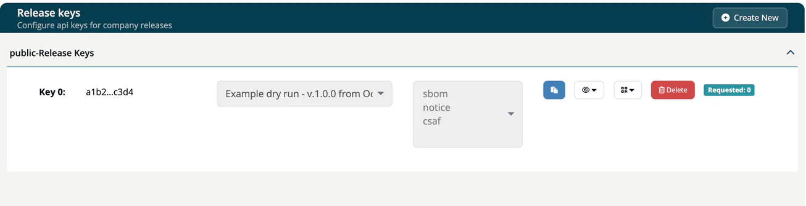

# Public Approves

> [!NOTE]
> **Required role:** `compliance_manager` to approve. Managing release keys needs `compliance_manager`, `manager` or `account_admin`.

Public approves let you share the documents of an approved release with **external stakeholders** (customers, auditors, partners) without giving them a ***TrustSource*** login or an API key.

## How it works

1. Approve the request. See [Approve / Reject](03-approve-reject-workflow.md).
2. ***TrustSource*** creates a **published release key** for the approval automatically. While that key serves the approval, approving the same request again does not add a second key.
3. Give the key to the external party, or ship it with your product. They fetch the SBOM, the notice file and the CSAF document under `https://api.trustsource.io/v2/compliance/releases/{release_key}/...`.

You do not have to mark an approval as public.

To see the keys of a release, copy, publish, unpublish or delete one, or create another one, click **Published keys** on the [release](../07-releases.md). To limit what a key serves, change its scope, show its URL as a QR code, or take it offline, open **Administration → API keys → Release keys**. The **API keys** menu entry is shown to `account_admin` only. See [Release keys](../../06-administration/04b-release-keys.md).

The **Packageurl** you enter in the [approval wizard](01-request-approval.md#the-five-steps) is stored with the approval and identifies the release for the public vulnerability exchange (VEX).

This is useful for CRA compliance: you can provide customers with proof of your software composition without exposing your internal tooling.

> [!CAUTION]
> Anyone who holds the key can read what it serves. Treat it like a password.

## Related

- [Approve / Reject](03-approve-reject-workflow.md): finalizing the approval
- [Release keys](../../06-administration/04b-release-keys.md): scope, URL and QR code of a key
- [REST API → Public Routes](../../09-rest-api/05-public-routes.md): the routes behind release keys
