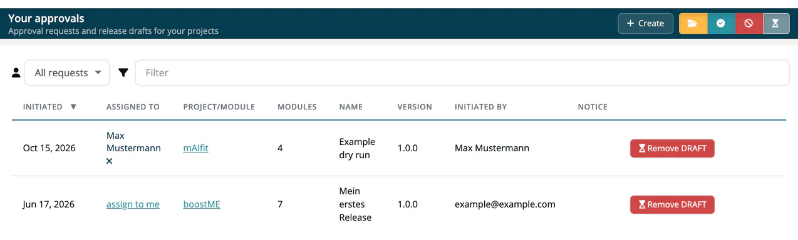

# Approvals

> [!NOTE]
> **Required role:** `manager` or `compliance_manager` to start an approval (the **Approvals** menu is shown to these two roles). Only a `compliance_manager` sees the **Approve** and **Reject** buttons.

An **approval** is a formal quality gate before shipping. It captures a frozen snapshot of selected module analyses and runs it through review tabs covering vulnerabilities, licenses, versioning, viability, status changes, export control, capabilities and (with the `sarif` license) SW quality. An approved request becomes a [release](../07-releases.md).

## Lifecycle

```
Dry run (draft) → Open request → Approved / Rejected
```

1. A **manager** or **compliance manager** starts the approval wizard for a project or a module, either as a **Dry run** or as a real request. Other roles get a `403` when they try to start a real request, and nothing is saved; a dry run is accepted from every member of the company.
2. A real request is offered to the compliance managers. It is assigned to the default compliance manager of the module or project, if one is set; otherwise a compliance manager takes it.
3. The compliance manager reviews the tabs and **approves** or **rejects**.
4. Once decided, the app no longer offers **Approve** or **Reject** for the request.

## The approvals list

Open **Internal → Approvals**. The page **Your approvals** lists the requests, newest first, and opens the approval when you click a row. A compliance manager can see every request of the company, dry runs included. A manager sees the requests of the projects they manage (projects without assigned users, or where they are the default project manager) and their own dry runs.

The selector next to the filter field narrows the list: **My requests** (the default) shows the requests assigned to you, **Unassigned** those without an assignee, and **All requests** everything you can see.

| Column | Meaning |
|---|---|
| **Initiated** | When the request was created. |
| **Assigned to** | The compliance manager who owns the request. |
| **Project/Module** | What is being approved; click to open it. |
| **Modules**, **Name**, **Version** | Number of modules, name and version of the request. |
| **Initiated by** | Who created it. |
| **Notice**, **SOUP** | How far the notice file and the SoUP list are completed, in percent. **SOUP** appears only when SoUP reports are part of your plan. |
| (last column) | **Approve** and **Reject** for open requests (compliance manager only), **Remove DRAFT** for dry runs, or the result with approver and date. |

The four status buttons in the page header show or hide each state. They show icons only (folder, check mark, ban sign and hourglass):

| Button | Status |
|---|---|
| **Open** | Waiting for a decision. |
| **Approved** | Approved. |
| **Rejected** | Rejected; hover over the badge to read the reason. |
| **Draft** | A dry run that was not sent to the compliance managers. |

A request is a draft whatever else is set on it; otherwise it counts as approved, then rejected, otherwise open. The API reports the same status. See [Compliance approvals](../../09-rest-api/endpoints/compliance-approvals.md).

## In this section

| Page | What it covers |
|---|---|
| [Requesting an Approval](01-request-approval.md) | How to create and submit an approval request. |
| [Approval Detail Tabs](02-approval-detail-tabs.md) | What each review tab contains (Overview plus up to eight tabs). |
| [Approve / Reject](03-approve-reject-workflow.md) | The decision workflow and what happens after. |
| [Binary Linking](04-binary-linking.md) | Attaching binary references to an approval. |
| [Public Approves](05-public-approves.md) | Sharing approved releases with external stakeholders. |
| [Post-Release Vulnerabilities](06-post-release-vulnerabilities.md) | Monitoring for new CVEs after a release. |


