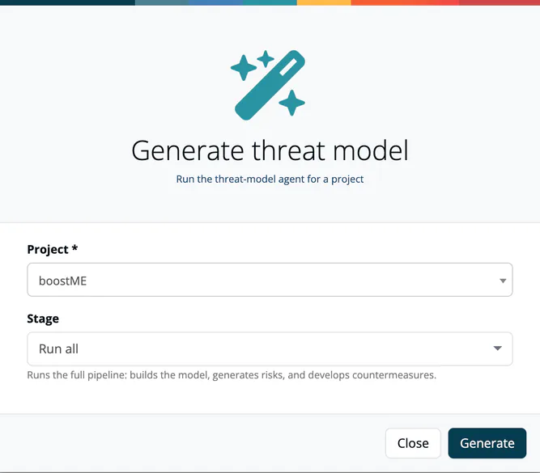

# Generate or Import a Threat Model

> [!NOTE]
> **Required license feature:** `threat`

A threat model is produced one of two ways: **generated** by the
[Threat Modeling Agent (TMA)](../../13-capabilities/07-threat-model-agent.md),
or **imported** from an existing OTM, OWASP Threat Dragon or CycloneDX
TM-BOM document.

## Generating a model

1. Click **Generate** on the Threat Models list (choose a **Project** in
   the dialog), or **Generate threat model** in the **Threat models**
   section of a project's Risks page (the project is pre-selected; the
   button is shown to the `manager` and `compliance_manager` roles). That
   section also lists the project's models.
2. Pick a **Stage**:

   | Stage | What it produces |
   |---|---|
   | **Run all** (default) | Builds the model, generates risks, then develops countermeasures. |
   | **Build model** | Inventory, system model and Data Flow Diagram only. |
   | **Generate risks** | STRIDE risks for an existing model. |
   | **Develop countermeasures** | Countermeasures for the existing risks. |

3. Click **Generate**. The run starts in the background (it can take up
   to ten minutes), and a **live progress panel** shows the run status, elapsed
   time and, per phase, a status icon (running / completed / failed). A
   "View document" link appears once it's done, and you're notified if the
   run fails, times out, or the agent is already busy at its concurrency
   limit.

Every run is **idempotent**: running a stage again with nothing new to
act on produces no new risks and a structurally identical document. A
completed run stores its result as a new document of the project; the
**Lifecycle** menu offers **View generated model** when you are looking at
an older one. See
[Run Modes](04-run-modes.md) for when to use each stage.

The agent reads the project's **Application goals** text (see
[Project Settings → General](../01-projects/settings/01-general.md)) to seed
the model. For the best result, fill in that field, or replace it with an
`architecture.md` via **Upload file**, before generating.

## Re-running a single stage

Open a model's detail page and use the **Lifecycle** dropdown: it lists
each stage, shows whether it already has data, and lets you run or re-run
just that stage without going back to the project.

## Importing a model

1. On the Threat Models list, press **Import**.
2. Choose the **Project** the model belongs to.
3. Select the **Document file**: an OTM file (`.yaml`, `.yml`), an OWASP Threat Dragon file (`.json`) or a CycloneDX TM-BOM (`.json`).
4. Check the **Format**. It is detected from the file; change it if the detection is wrong. The options are *Open Threat Model (OTM)*, *OWASP Threat Dragon* and *CycloneDX TM-BOM (2.0 draft)*.
5. Press **Import**.

The model appears in the list next to generated models and opens in the same Data Flow Diagram viewer. An imported **TM-BOM** is read-only: the viewer shows a projection of the document and you cannot edit it there. TM-BOM is a CycloneDX 2.0 draft format.

## Downloading or deleting a model

Open a model and press **Download**. The menu offers, depending on how the model is stored:

| Option | Gives you |
|---|---|
| **TrustSource (complete)** | Everything stored, including TrustSource-specific fields. The default. |
| **OTM (spec-compliant)** | Only the fields defined by OTM v0.2.0, for tools that validate strictly. A message says how many fields were removed. Available for OTM models. |
| **TM-BOM (CycloneDX 2.0 draft)** | The model as a CycloneDX TM-BOM. Not offered for a model that already is one. |

A stored TM-BOM has a single **Download** button that returns the document as stored. Threat Dragon models offer the complete download and the TM-BOM export.

**Delete** on the detail page, or **Remove** in the Threat Models list, deletes the document after a confirmation.

## Related

- [Run Modes](04-run-modes.md) - Complete run vs. individual stages
- [Data Flow Diagram & Threat Detail](02-threat-detail-stride-linddun.md)
