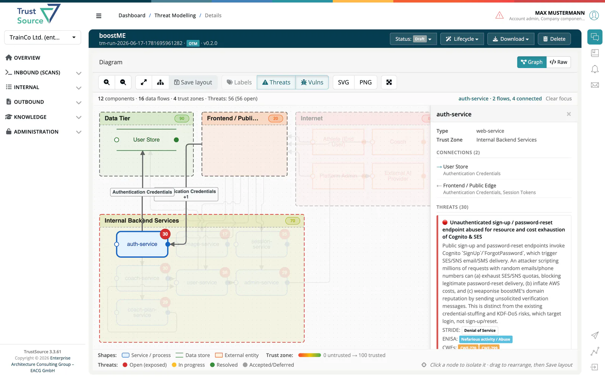

# Data Flow Diagram & Threat Detail

> [!NOTE]
> **Required license feature:** `threat`

A threat model's detail page renders it as an interactive **Data Flow
Diagram (DFD)**: components, trust zones and data flows, with a Graph / Raw
toggle to see the underlying document. This is the human review surface on
top of the [Threat Modeling Agent's](../../13-capabilities/07-threat-model-agent.md)
**Generate risks** stage: the threats it elicited are what you review and
act on here.

## Reading the diagram

- **Toolbar:** zoom in/out, fit, auto-layout, Save layout, **Labels**,
  Threats and Vulnerabilities overlay toggles, SVG/PNG export, fullscreen.
  Exports match what is on screen, including hidden labels.
- **Labels** shows the name of what each data flow carries. On a busy
  diagram the labels start hidden so they do not cover components; press
  **Labels** to show them all. A flow carrying several things names the main
  one and counts the rest.
- **Click a component to isolate it.** The rest fades back; the component,
  everything it exchanges data with and the flows between them stay lit and
  are labelled. Hovering previews the same. Press `Escape`, click the
  background or click **Clear focus** to return to the full diagram. The bar above the diagram names
  what is in focus and counts the components, data flows and trust zones.
- Each trust zone has a title bar with its trust rating. The legend explains
  the shapes (service / process, data store, external entity), the trust
  scale (0 untrusted to 100 trusted) and the threat colours; the threat
  colours are left out for a model without threats.
- Manually arranged node positions are **saved** and preserved across
  reloads and later agent runs; Auto Layout asks for confirmation before
  discarding a manual arrangement.
- Each node shows a **threat count badge**. Components with known
  vulnerabilities show one pill per vulnerability with its ID and
  severity, at most five; further ones are counted in a "+N more" pill
  that opens the side panel's vulnerability list.
- Trust zones can be resized by dragging a corner (when you have edit
  rights).

## Review status

Each model has a status, set from the **Status** menu in the header: *Draft*, *Reviewed* or *Approved*. The status is shown in the Threat Models list.

## Threat detail side panel

Clicking a component, data flow or trust zone opens a side panel with:

- Metadata for the selected element; for a component, the data flows it is
  connected to, the component at the other end and what travels over each.
- Threat cards classified by **STRIDE**, **ENISA** category and **CWE**,
  each coloured by the threat's state as stored in the model (open, in
  progress, resolved, accepted or deferred; see the legend).
- Countermeasure rows for that threat, with an icon for their status (see
  [Mitigations & Status](03-mitigations-status.md)).
- Matching vulnerabilities for that component.

The **Generate risks** stage files each threat as a risk in the project's
[risk register](../05-risks/index.md) with the origin *TMA Assessment*. Open
these risks in the [Risks list](../05-risks/02-risks-list.md); their **Threat model** tab holds
the threat-model context. Once you set a state on such a risk, that is a
**human decision the agent will not overwrite** on later runs.
See [Run Modes](04-run-modes.md#what-the-agent-will-not-touch).

## Related

- [Mitigations & Status](03-mitigations-status.md) - tracking countermeasures
- [Run Modes](04-run-modes.md) - re-eliciting threats via Generate risks
- [Background: Product Security](../../../shared/background/05-product-security.md)
