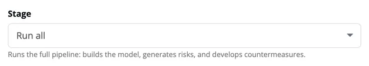
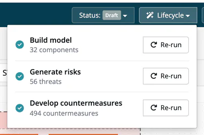

# Run Modes

> [!NOTE]
> **Required license feature:** `threat`

The threat model for a project is produced by the
[Threat Modeling Agent (TMA)](../../13-capabilities/07-threat-model-agent.md).
You can either run the whole pipeline in a single pass or trigger the
three underlying actions independently. Both paths are fully automated.

## Run all

**Run all**, the default option in the Generate dialog, executes every
stage end-to-end: system model → threat elicitation → countermeasure
proposal → write-back. This is the right choice when

- you are enabling threat modelling on a project for the first time,
- your modules changed in ways that could affect several stages
  (new modules, structural refactor, new external dependencies), or
- you have not run the model in a while and simply want it refreshed.

## Individual stages

The same pipeline is also exposed as three stages you can pick in the
Generate dialog, or trigger (and re-trigger) separately from a model's
**Lifecycle** dropdown:

| Stage | What it does |
|---|---|
| **Build model** | Rebuilds the system model from the current project inventory and the project's Application goals: trust zones, components, data flows, datastores, assets. When nothing it reads has changed since the last run, the stored model is reused. |
| **Generate risks** | Runs STRIDE analysis on new / changed components in the system model and records the threats it finds. |
| **Develop countermeasures** | For every agent risk that has no countermeasure yet, proposes one to three countermeasures with a standards reference, an estimated risk reduction, and a validation method. Risks that already have a countermeasure, or that carry a human decision, are skipped. |

Use the individual stages when you want to

- **review the system model before threats are elicited**: Build model
  produces the model; look it over in the DFD viewer, answer the
  questions in the [Model review](02-threat-detail-stride-linddun.md#model-review)
  panel, run **Run model step now** if needed, then trigger Generate risks;
- **re-elicit threats after new information**: you added a new
  external interface or corrected a component's trust zone and want
  the STRIDE analysis re-done without touching countermeasures;
- **add countermeasures later**: run Generate risks, review the new risks
  first, then run Develop countermeasures for the risks that still have
  none. It does not replace countermeasures that already exist.

## Idempotence: safe to re-run

Every stage, whether run via "Run all" or individually, is
**idempotent**. Running a stage a second time with no new material
produces zero new risks and a
structurally identical Open Threat Model (OTM) document. You do not
need to worry about generating duplicate risks or spurious noise by
re-triggering; the agent examines what has changed since the last run
and only acts on the delta.

This has two practical consequences:

- You can trigger a refresh **whenever** you are unsure whether the
  model still reflects reality; worst case, nothing happens.
- A module in which the STRIDE analysis found no threat is marked as
  reviewed with nothing found on that date, by **Run all** as well as by
  **Generate risks**. When you run **Generate risks** on its own, such a
  module is skipped by later runs of this stage; the marker expires
  after 60 days by default, so quiet parts of the project are still
  periodically re-examined. Infrastructure and COTS components that
  already have agent risks are not analysed again.
- If a run stops before its results are saved (for example while
  writing the risks), the next run analyses every component that has
  neither threats in the model, nor the reviewed marker, nor an agent
  risk. Nothing is lost by re-running.
- A component the analysis cannot handle is skipped with a note in the
  run log; the rest of the run completes.

## What the agent will not touch

The agent respects **human decisions**. Once a person has

- moved a risk from `identified` to any other state (for example
  `approved` or `closed`), or
- set a countermeasure to completed, verified or ok,

subsequent runs will never overwrite those states. When the underlying
module of a threat has been removed, the agent marks the risk
`out-of-scope` instead of deleting it, so the audit trail stays intact.
***TrustSource*** stores that legacy value as state `closed`, with the
strategy Accept if the risk had none (see [Treatment and State](../05-risks/05-treatment-and-state.md#older-risks)).

## Related

- [Threat Modeling Agent](../../13-capabilities/07-threat-model-agent.md) - capability overview and guarantees
- [Generate or Import a Threat Model](01-create-threat-model.md) - enabling threat modelling on a project for the first time
- [Data Flow Diagram & Threat Detail](02-threat-detail-stride-linddun.md) - reviewing an elicited threat
- [Mitigations & Status](03-mitigations-status.md) - tracking countermeasures across runs
