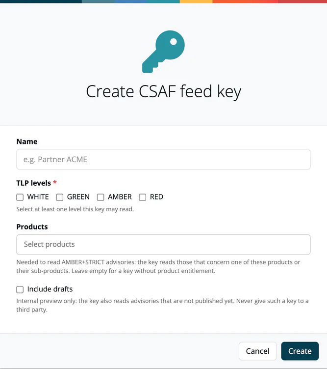

# CSAF Documents

> [!NOTE]
> **Required license feature:** `csaf`
> **Who can do what:**
> - Create an advisory: `manager`, `compliance_manager`, `company_security_manager`, `account_admin`
> - Edit, delete, mark as AMBER+STRICT and run checks: `compliance_manager`, `company_security_manager`, `account_admin`
> - Publish an advisory: `company_security_manager`
> - Manage feed keys: `account_admin`
>
> The **Outbound** menu is shown to `compliance_manager`, `manager` and `account_admin`; a `company_security_manager` without one of these roles opens the CSAF list directly at `/csaf`.

CSAF (Common Security Advisory Framework) documents are structured security advisories that describe vulnerabilities in your products and the remediation steps you have taken. ***TrustSource*** checks them against the CSAF 2.0 standard, publishes them to your CSAF provider and can hand restricted advisories to selected recipients through access-protected feeds.

## What you can do

- **Create** an advisory with the wizard (steps Type, Meta, Affected, Vulnerabilities, Remediations), start one from the findings you select in the [Vulnerability report](../03-internal/04a-vulnerability-report.md) (**Treatments → Create CSAF**), or **Import** an existing CSAF file.
- **Edit** across the tabs **Meta information**, **Affected**, **Remediation**, **Checks**, **History** and **JSON**.
- **Check** an advisory against the CSAF 2.0 mandatory tests before you publish it.
- **Publish** an advisory to the provider directory that matches its TLP label, and keep every published version.
- **Share restricted advisories** with a recipient through a feed key, optionally limited to the products that recipient is entitled to (AMBER+STRICT).

📸 *Screenshot: the CSAF document editor with the Meta information tab active.*

## The life of an advisory

An advisory moves through four steps:

1. **Draft.** A new advisory has the status `draft`. Drafts are internal. They are never served to recipients, except through a feed key that you created with *Include drafts* (see [Internal preview](#internal-preview-with-drafts)).
2. **Check.** Open the **Checks** tab and press **Run check now**. See [Checks](#checks).
3. **Publish.** Press **Publish** in the advisory header or in the list row. The advisory becomes `final` and is uploaded to the provider.
4. **Versions.** Every publish keeps an exact copy. The **History** tab lists them under *Published versions*.

> [!NOTE]
> A published advisory can no longer be removed. If a published advisory is wrong, publish a corrected version instead.

### Checks

The **Checks** tab shows the result of the CSAF 2.0 *mandatory tests* for the advisory. The **Check** column in the CSAF list shows the same result at a glance.

| State | Meaning |
|---|---|
| **Passed** | All mandatory tests passed. |
| **Failed** | At least one mandatory test failed. The tab names each failed test and where in the document it failed. |
| **Stale** | The document changed after the last check. Run the check again. |
| **Not run** | No check has run yet. |

Optional tests are listed too, but they never block publishing. If the document does not match the CSAF 2.0 schema, the other tests are not run. Fix the schema errors first, or edit the document in the **JSON** tab.

Publishing is refused when a mandatory test fails or when the version number is already published. The message names the failed tests. Open the Checks tab for details.

> [!NOTE]
> The schema validation is strict (CSAF 2.0, JSON Schema 2020-12). Documents or imports that were accepted by older releases can be rejected now. Documents over 5 MiB are refused.

### Published versions and version numbers

- The next version number follows the highest number in the advisory's revision history.
- **History → Published versions** lists each published version. **View JSON** shows it, **Download** saves it.
- Recipients can request an earlier version from the feed with `?version=N`, see [Feed endpoints](#feed-endpoints).

## TLP: where an advisory is published

The **TLP label** of the document (**Meta information** tab, field **Label of TLP**) decides where the advisory is published. *TLP* is the Traffic Light Protocol, which classifies how widely information may be shared.

| TLP label | Published to |
|---|---|
| `WHITE` | The public provider directory. Anyone can read it. |
| `GREEN`, `AMBER`, `RED` | The provider directory of the same name. Your provider must serve these directories **only with authentication**. |

Rules:

- An advisory **without** a TLP label is treated as `WHITE`.
- A label that is not a CSAF 2.0 level is **refused** at publish time. It is never guessed.
- The canonical URL inside the document points to the same directory the file was uploaded to.

> [!WARNING]
> Check with your CSAF provider before you publish the first advisory with a label other than `WHITE`. The directories `green`, `amber` and `red` must exist and must require authentication. Otherwise a restricted advisory is publicly readable.

## Sharing restricted advisories: feed keys

A restricted advisory is not meant for the public. You give each recipient a **feed key**. The recipient uses the key to list and read exactly the advisories the key allows.

Create and manage keys under **Administration → API keys** (page **Scanners & API keys**): the card **CSAF feed keys** opens the page of the same name. The card is shown only with the `csaf` feature. **Create key** opens the dialog **Create CSAF feed key**; **Create** saves the key.

| Field | What it does |
|---|---|
| **Name** | Your label for the recipient, for example *Partner ACME*. |
| **TLP levels** | The levels this key may read. Select at least one. A level you did not select answers `404`. |
| **Products** | Only with the *Products* feature. The products this key is entitled to. Needed for AMBER+STRICT advisories, see below. |
| **Include drafts** | Internal preview only. See [Internal preview](#internal-preview-with-drafts). |

Per key you can **copy** it, edit its **Products**, open its **Access log**, switch **drafts** on or off, **Publish** it to activate it or **Unpublish** it to switch it off. **Delete** is available for unpublished keys.

### Access log

Every read through a key is recorded: which key read which advisory, and when. Open it with the **Access log** button of the key. Entries are kept for 365 days. The *Requests* column shows the number of reads.

### What a recipient sees

- A key sees only **published** advisories, exactly **as last published**. Later edits stay internal until you publish again.
- An advisory that the key may not read answers **`404`**, the same as a document that does not exist. A recipient cannot learn that a restricted advisory exists.
- Without the `csaf` feature the feed answers `404` for every key.

### Feed endpoints

| Request | Returns |
|---|---|
| `GET /compliance/csaf/{key}/documents` | The advisories the key may read, newest first. Each item carries `version`. |
| `GET /compliance/csaf/{key}/documents/{id}` | One advisory. |
| `GET /compliance/csaf/{key}/documents/{id}?version=N` | An earlier published version. |

### Internal preview with drafts

A key created with **Include drafts** also reads advisories that are not published yet. Use it for your own review tooling only.

> [!CAUTION]
> Never give a key with *Include drafts* to a third party. It exposes unpublished advisories.

## AMBER+STRICT: advisories restricted to a product

Some recipients may read an advisory only if it concerns a product they are entitled to. This is typical for critical infrastructure (KRITIS) customers. Mark such an advisory **AMBER+STRICT**.

An AMBER+STRICT advisory is served only to a feed key that is **bound to a product the advisory concerns**. Keys bound to a parent product also read advisories about its sub-products. Every other key gets `404`, including keys that may read TLP `AMBER`.

> [!NOTE]
> CSAF 2.0 cannot carry the label *AMBER+STRICT* inside the document. The document stays `AMBER`. ***TrustSource*** keeps the restriction as a marker on the advisory and enforces it in the feed.

### Set it up

1. **Link the affected release to a product.** In the product, open the **Solutions** tab and use **Add solution**. See [Link with Release](../03-internal/03-products/10-link-with-release.md). The advisory's products come from the releases that contain the affected modules. Without this link, no key can read the advisory.
2. **Set the TLP label to `AMBER` and save the advisory.** Only an `AMBER` advisory can be marked.
3. **Mark it.** On the **Meta information** tab, tick **AMBER+STRICT (product-restricted)**. The advisory then shows which products it concerns. If it shows *no product yet*, go back to step 1.
4. **Bind the recipient's key to the product.** Create a key (or use the **Products** button of an existing key) and select the products the recipient is entitled to.
5. **Publish the advisory.**

📸 *Screenshot: the AMBER+STRICT option on the Meta information tab, with the products the advisory concerns.*

### What to expect

- The recipient receives the **whole** advisory, not a filtered copy. The advisory is not reduced to the part that concerns the recipient's product.
- A key without products reads no AMBER+STRICT advisory. A key without products still works for the TLP levels it was created with.
- Each published version keeps the products it concerned at the time. An older version is served by the products of that version.
- To withdraw the marker, untick **AMBER+STRICT** and publish again.

### If something does not work

| Symptom | Cause and fix |
|---|---|
| The AMBER+STRICT option is missing. | The saved TLP label is not `AMBER`. Select AMBER, save, then tick the option. |
| The advisory shows *no product yet*. | No release containing an affected module is linked to a product. Link the release to a product. |
| A recipient gets `404`. | The key has no matching TLP level, is not bound to a product the advisory concerns, or is unpublished. Check the key's TLP levels, Products and status. |
| Publishing is refused. | A mandatory test failed, or this version is already published. See the [Checks](#checks) tab. |
| A recipient sees older content. | Feeds serve the advisory as last published. Edits become visible after you publish again. |

## Justifications in VEX documents

Findings that you mute in a module carry their reason into the advisory. The reasons *False positive* and *Vulnerable code not in use* are published as a CSAF justification flag. You can change the justification in the **CVE is muted** dialog. In the CSAF wizard, you can also set a justification for products marked *Known not affected*.

The published status follows the reason you select, not the text of your comment. A CVE muted in one module is no longer published as *not affected* for the other modules of the project. A fix that is about to be implemented is published as *known affected*.

## Related

- [Background: VEX in CSAF](../../shared/background/11-vex-csaf-vex.md) - VEX use cases
- [Link with Release](../03-internal/03-products/10-link-with-release.md) - connect releases to products
- [Products](../03-internal/03-products/index.md) - products referenced in CSAF advisories
- [CSAF Trusted Provider](../13-capabilities/06-csaf-trusted-provider.md) - the capability behind publishing
- [Vulnerability Lake](../05-knowledge/04-vulnerability-lake.md) - the CVE database
