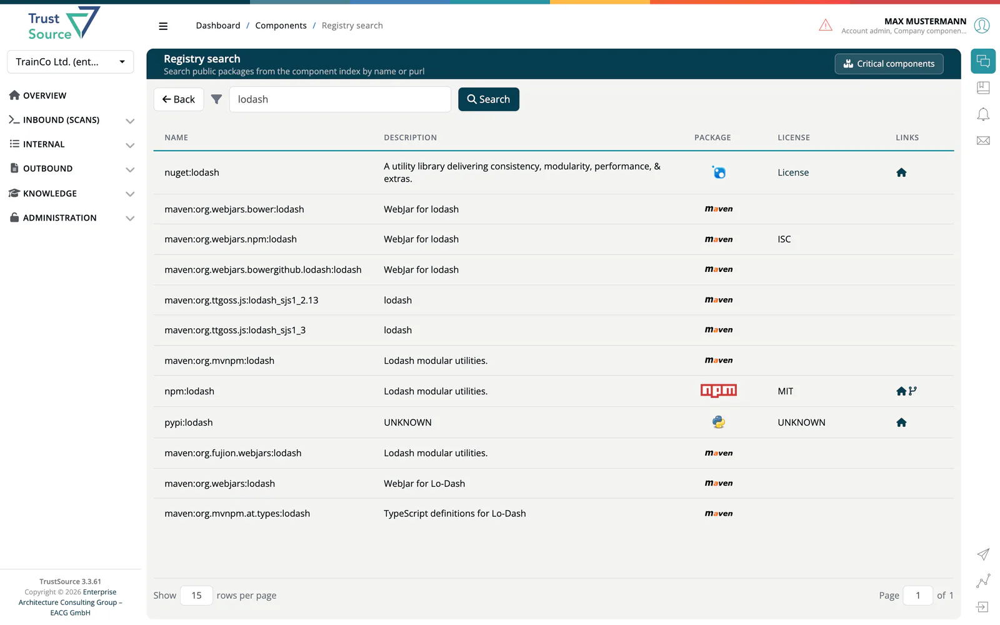

# Component Lake

The Component Lake is ***TrustSource***'s component library. Use it to look up a package, check its licenses, versions and vulnerabilities, or to find out where your company already manages it. Open it from **Knowledge → Component Lake**.

## Choose where to search

The page first asks **Where do you want to search?** and offers two cards. The logos on the first card show the ecosystems ***TrustSource*** scans (Maven, Cargo, Dart, Go, Gradle, npm, NuGet, PyPI).

| Search | Searches | Who |
|---|---|---|
| **Registry search** | Public packages from the component index, by name or purl. | Everyone |
| **Internal search** | The components your own company manages. An empty field lists all of them. | Everyone |

Searches run when you press **Search**, not on every keystroke. The search is part of the page address, so it survives a reload and can be shared. **Back** returns to the cards.

### Registry search

Results show **Name**, **Description**, **Package** (ecosystem icon), **License** and **Links** to the homepage and repository. Besides the ecosystems above the index also lists Swift and CRAN packages. Select a row to open the package page: licenses, homepage, repository, maintainer and Maven coordinates, and for each version its size, checksum, source archive and Maven artifacts. Vulnerabilities are looked up for every listed version, so a preloader may appear briefly.

### Internal search

Results show **Name**, **Description**, **Package**, an **OSSF** score and **Links**. Sort by *Name*, *Key*, *Language* or *Description*, ascending or descending. A red **B** marks a component blacklisted in your company. Hover over the OSSF box to see the Scorecard checks and the date of the last run.

## Component page

A component page shows the information (key, purl, homepage, repository, language, last update), a comment and the **Versions** table with license, checksum and copyright per version. Type part of a version into **Filter versions** to narrow the list; the badge changes to, for example, "2 of 4 versions".

The component data is maintained by ***TrustSource***.

> [!TIP]
> Users with the Company Component Manager role also find a **Critical components** button here, which opens the company [Components report](../03-internal/04c-impact-and-portfolio-reports.md#components).

