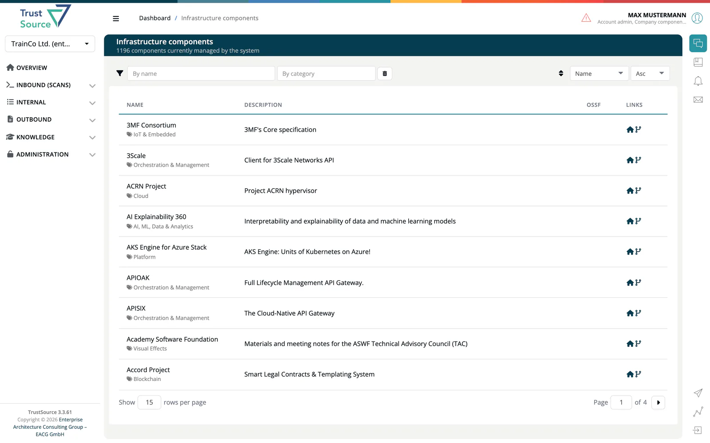

# Infrastructure Elements

The Infrastructure Elements catalogue lists the infrastructure components ***TrustSource*** knows (operating systems, base images, database servers, web servers, message brokers) that you can link to [infrastructure modules](../03-internal/02-modules/03-infrastructure-modules.md). Open it from **Knowledge → Infrastructure Elements**; the page is titled **Infrastructure components**.

## Browse the catalogue

The header shows how many components are managed. Use the filter bar to narrow the list. Each row shows the component name, its categories, a short description, the OpenSSF score and links to the homepage and repository. A red **B** means that all or some versions are blacklisted in your company.

Select a component to open its page: the **Information** panel (key, purl, whether it is private, homepage, repository, language, last update), the **Comment**, the **Versions** with licenses and, if they were entered, the commercial terms. A filter above the versions table narrows long lists.

> [!NOTE]
> Everyone can read the catalogue. Users with the `component_manager` role also see **Add infrastructure component**, **View used as Modules** and an **Edit** button. See [Manage Infrastructure Components](../14-component-manager/01-manage-infrastructure.md).

