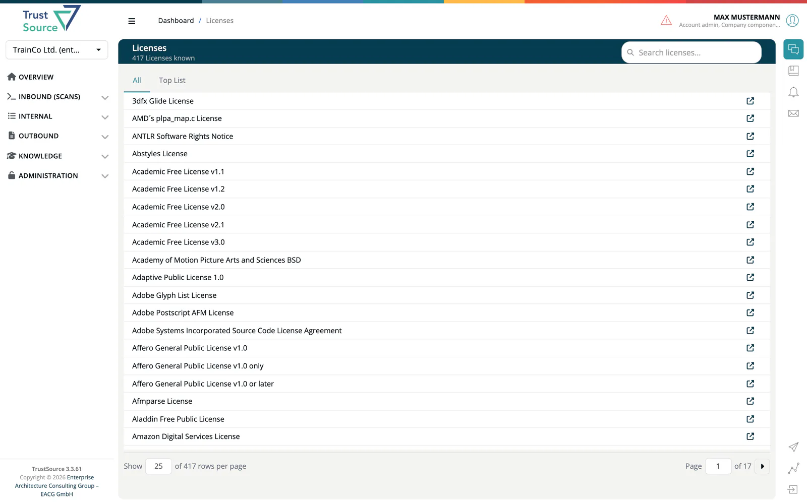

# Licenses

The license database lists every license ***TrustSource*** knows, with its full text. Use it to read what a license says, or to find the identifier to use when you assign a license by hand. Open it from **Knowledge → Licenses**.

## Find a license

The header shows how many licenses are known. Type into **Search licenses...** to filter by name or SPDX identifier; matches are highlighted. Two tabs organise the list:

- **All** lists every license alphabetically, with paging.
- **Top List** lists the licenses used most often across ***TrustSource***.

Each row shows the license name and a link to the license homepage. Select a row to open it.

## License details

The detail page is titled with the license name and its identifier in brackets, for example *MIT License [MIT]*. It shows the **License text** with the creation and update dates. **Search in license text...** highlights a phrase in the text.

If ***TrustSource*** does not hold the text, the page says so and links to the official text instead.

> [!NOTE]
> The license catalogue and the legal assessment of each license are maintained by ***TrustSource***.

The catalogue also contains the special identifiers `NO-LICENSE`, `PUBLIC-DOMAIN` and `UNKNOWN`. Use them when you assign a license by hand to a component the scan could not match.

## Related

- [Open Source Policy](07-open-source-policy.md) - the policy document your company publishes
