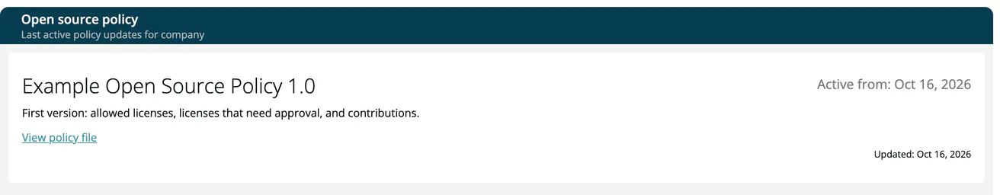

# Your Open Source Policy

**Knowledge → Open source policy** shows the open source policy that is active in your company. Compliance managers publish the policy as a document under [Administration → Policies](../06-administration/05-policies.md#opensource-policy); this page is read-only.

The page shows the policy name with its **Active from** date, its description, a **View policy file** link to the document and the date of the last update. Opening the file is recorded for the policy.

When a new or updated policy becomes active, ***TrustSource*** shows it to you in a **New policy updates** window. **Confirm** records that you have read it.

If your company has no active policy, the page says so and links to your compliance manager and account administrators by e-mail.

## Related

- [Policies (Administration)](../06-administration/05-policies.md) - company-wide policy management
