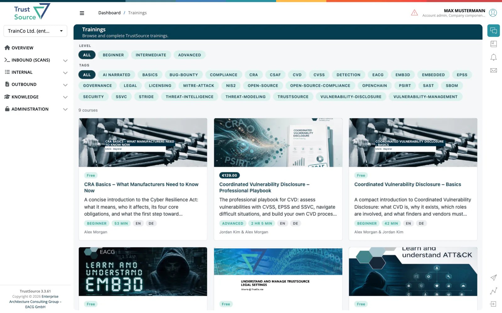

# Trainings

The Trainings page gives you access to ***TrustSource*** training courses. Open it from **Knowledge → Trainings**.

By default the training platform opens inside the page: you sign in automatically with your ***TrustSource*** account, browse the courses and complete lessons without leaving the application. A link to a lesson (`/trainings?id=...&lesson=...`) opens that lesson directly, so you can share it with colleagues.

If your company runs its own training portal, **Trainings** in the menu opens that portal in a new browser tab instead.

> [!TIP]
> If the page shows an error instead of the course list, reload it. If the error stays, contact [support](../../shared/support.md).

