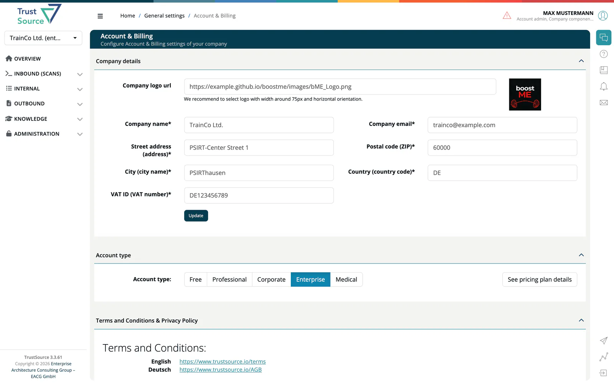

# Account & Billing

> [!NOTE]
> **Required role:** `account_admin` or `enterprise_admin`

**Administration → Account & Billing** holds your company data, your account type and the legal documents. Use it to keep invoices correct and to change your plan. See [Account Types](../00-getting-started/02-account-types.md) for what each plan includes.

## Company details

Fill in this form before you change your plan. Fields marked * are required. Select **Update** to save.

| Field | Description |
|---|---|
| **Company logo url** | Address of your logo. |
| **Company name*** | The name of your company. |
| **Company email*** | The contact address for your company. |
| **Street address (address)*** | Billing address. |
| **Postal code (ZIP)*** | Postal code of the billing address. |
| **City (city name)*** | City of the billing address. |
| **Country (country code)*** | Country code, for example `DE`. |
| **VAT ID (VAT number)*** | Your VAT number. |

## Account type

Choose **Free**, **Professional**, **Corporate**, **Enterprise** or **Medical**. **See pricing plan details** shows the limits and monthly price of each plan.

- **Upgrade to Professional or Corporate:** a dialog confirms the new account type and the monthly charge. The first charge happens when you confirm. Where a trial is available, **Start trial** starts it instead; the dialog shows when a running trial expires.
- **Upgrade to Enterprise or Medical:** your request goes to the sales team, who contact you within 24 hours.
- **Downgrade:** takes effect with the next billing period. The dialog asks why you leave.
- **Billing information first:** **Ok** stays disabled until the company details above are complete.

You must accept the terms and conditions in each dialog.

> [!NOTE]
> Which optional features your company can use, such as Products, Risks or CSAF, is not set here. TrustSource provisions these license features for your company. See [License Features](../10-roles-permissions/07-license-features.md).

## Terms and conditions and privacy policy

The last panel links to the terms and conditions and the privacy policy in English and German.

## Related

- [Account Types](../00-getting-started/02-account-types.md)
- [Enterprise Companies](06-enterprise-companies.md)
