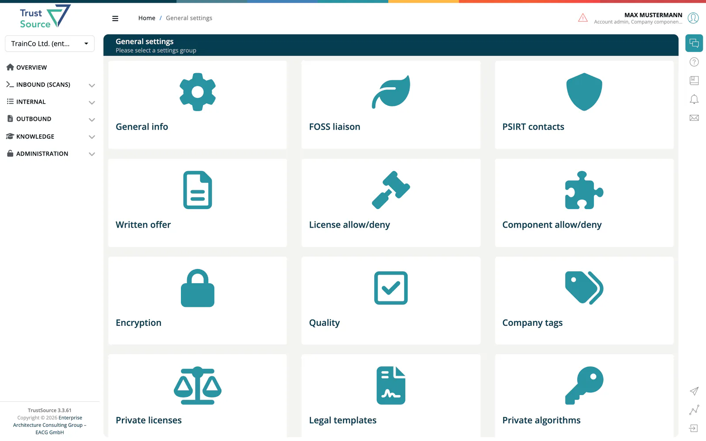

# Settings

> [!NOTE]
> **Required role:** `account_admin`, `compliance_manager`, `company_security_manager`, `company_component_manager`, `portfolio_manager` or `manager`
>
> Each card is only visible to the roles that own it. Users without any matching role do not see **Administration → Settings**.

The **Settings** page ("General settings") is the entry point for company-wide configuration. It shows one card per settings group. What you see depends on your role: account admins see every card, other roles only the cards that belong to their work.

## Cards

| Card | What it configures | Visible to |
|---|---|---|
| **General info** | Distribution email, trainings URL, currency code, default vulnerability confidence level. See [Company details](02a-company-details.md). | `account_admin` |
| **FOSS liaison** | Contact for your open-source program office. See [Company details](02a-company-details.md). | `account_admin`, `compliance_manager` |
| **PSIRT contacts** | Manufacturer and product security contact data. See [Company details](02a-company-details.md). | `account_admin`, `company_security_manager` |
| **Written offer** | Text of your GPL/LGPL written offer. See [Company details](02a-company-details.md). | `account_admin`, `compliance_manager` |
| **License allow/deny** | Company-wide license allow and deny lists. | `account_admin`, `compliance_manager` |
| **Component allow/deny** | Company-wide component allow and deny lists. | `account_admin`, `compliance_manager`, `company_security_manager`, `company_component_manager` |
| **Encryption** | Export controls management. | `account_admin`, `compliance_manager`, `company_security_manager` |
| **Quality** | Test requirements. | `account_admin`, `company_security_manager`, `compliance_manager` |
| **Company tags** | The tag list for projects and modules. See [Company tags](02b-company-tags.md). | `account_admin`, `portfolio_manager`, `manager`, `company_security_manager`, `compliance_manager` |
| **Private licenses** | Licenses that are not in the public database. Only shown for Enterprise and Medical accounts. | `account_admin`, `compliance_manager` |
| **Legal templates** | Company templates for the legal requirements of projects and modules. See [Legal templates](#legal-templates). | `account_admin`, `compliance_manager` |
| **Private algorithms** | Cryptographic algorithms that are not in the public catalog. | `account_admin`, `company_security_manager` |
| **Manual vulnerability** | Vulnerabilities you track yourself because they are not in public feeds. | `account_admin`, `company_security_manager`, `company_component_manager` |

> [!NOTE]
> A card can be visible to a role that may only look at the page. For example, only account admins and managers can add or remove company tags.

## Legal templates

Legal templates are presets for the **legal requirements** of a project or module: how it is sold, operated and distributed, and what intellectual-property protection it needs. The **Legal templates** card opens **Company legal settings templates**. When the legal settings of a project or module are set up, a template can be imported with **Import settings from Template**, as described under [Project Settings → Legal](../03-internal/01-projects/settings/02-legal.md).

The list shows each template's **order**, **Type** (*Project* or *Module*) and **Name**. Select a row to open it; **Remove** deletes a template. Account admins add a template with **Create template**: enter a **Name**, choose the **Type** and optionally an **Order**, then press **Create Rule**.

On a template, change name and order under **Update template information** and press **Update template**. Below, set the requirements with **Start wizard** (a questionnaire that ends with **Finish**) or **View all** (all questions in one form), and press **Update legal requirements** to save. For a **Project** template the questions cover the *Commercial Aspects* (if unsure, choose *usage fee*, the most restrictive), the *Operating Model* (if unsure, choose the *embedded model*) and *Intellectual Property Aspects*. For a **Module** template they cover *Trade Secret Aspects*, the *Licensing Strategy* and the *Distribution of the module*.

## Related

- [Project Settings](../03-internal/01-projects/settings/index.md) - settings for one project
- [Module Settings](../03-internal/02-modules/settings/index.md) - settings for one module
- [Policies](05-policies.md) - open-source policy, crypto algorithms, end-of-life and risk assessment
- [Settings Permission Matrix](../10-roles-permissions/06-settings-permission-matrix.md)
