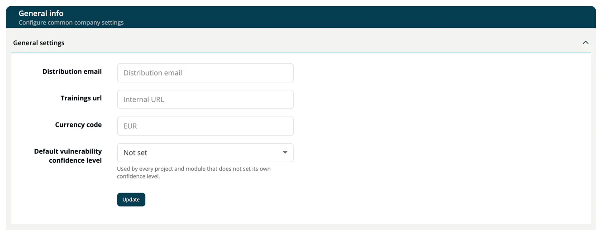

# Company details: general info, FOSS liaison, PSIRT and written offer

> [!NOTE]
> **Required role:** `account_admin`. FOSS liaison and Written offer are also edited by `compliance_manager`, PSIRT contacts by `company_security_manager`.

Four cards on **Administration → Settings** hold data about your company. Each form ends with **Update**.

## General info

| Field | Description |
|---|---|
| **Distribution email** | The distribution email address of your company. |
| **Trainings url** | An internal address. When you fill it in, **Trainings** in the Knowledge menu opens it. |
| **Currency code** | The currency for amounts in risks, for example `EUR`. When empty, `EUR` is used. |
| **Default vulnerability confidence level** | The minimum confidence for vulnerability matches. It applies to every project and module that does not set its own level. Choose **Not set** to clear it. |

## FOSS liaison

The contact for open-source questions, for example your open-source program office.

- **FOSS Liaison will be managed by EACG Operations Services:** tick this box to hand the liaison role to EACG. The contact fields then show the EACG details and are read-only. You must also confirm that you agreed to the service terms.
- Otherwise enter **Name of contact**, **Name of company**, **Postal code (ZIP)**, **Mail address**, **Postal address**, **Phone number**, **Country (country code)** and **Webpage**.

> [!NOTE]
> Handing the liaison to EACG notifies the TrustSource sales team.

## PSIRT contacts

Data for your Product Security Incident Response Team.

| Field | Description |
|---|---|
| **Registered Trade Name** | The registered trade name of your company. |
| **Manufacturer Name** | The name of the manufacturer. |
| **Manufacturer Address** | The postal address of the manufacturer. |
| **Manufacturer Website** | The web address of the manufacturer. |
| **Product Security Contact** | The contact for product security, for example `psirt@acme.example`. |
| **Weblink** | A web address for product security information. |

## Written offer

The text that offers recipients the source code of GPL/LGPL components. ***TrustSource*** uses it in your [notice files](../04-outbound/02-notice-files.md).

| Field | Description |
|---|---|
| **Title** | Heading of the offer. The default is "Open Source Announcement". |
| **Details** | The offer text. The default explains the three-year source-code offer and contains placeholders for the request address, which you must replace. |

**Update** saves your text. **Reset** restores the default title and text and saves them.

## Related

- [Settings](02-settings.md)
- [Notice Files](../04-outbound/02-notice-files.md)
