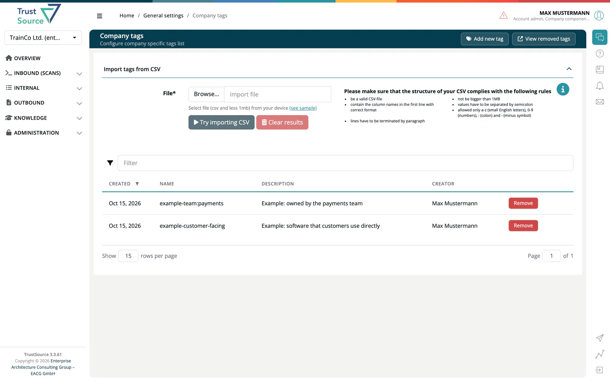

# Company tags

> [!NOTE]
> **Required role to open the page:** `account_admin`, `portfolio_manager`, `manager`, `company_security_manager` or `compliance_manager`
> **Required role to add, remove or import:** `account_admin` or `manager`

**Company tags** is the list of tags that projects and modules can carry. Open it from **Administration → Settings → Company tags**.

## Add a tag

1. Select **Add new tag**.
2. Enter the **Name**, 2 to 50 characters. Use only lowercase letters `a-z`, digits `0-9`, a colon `:` and a minus `-`, for example `customer-facing` or `team:payments`.
3. Optionally add a **Description**.
4. Select **Add tag**. A name that an active tag already has is refused.

## Import tags from CSV

Use **Import tags from CSV** to create many tags at once.

1. Prepare a semicolon-separated CSV file of up to 1 MB. The first line holds the column names `Name;Description`. Select **(see sample)** for an example.
2. Select **Browse...** and choose the file. The page shows **Expected results** with the lines it can import and the lines with an error, such as a duplicate or an invalid name.
3. Select **Import CSV** to create the tags. Until you choose a file, this button reads **Try importing CSV** and is disabled. **Clear results** resets the panel.

## Remove and re-activate

**Remove** in a row moves the tag to the removed list. Select **View removed tags** to see it, and **Re-activate** to bring it back. **View active tags** returns to the normal list.

## Related

- [Settings](02-settings.md)
- [Project General settings](../03-internal/01-projects/settings/01-general.md)
