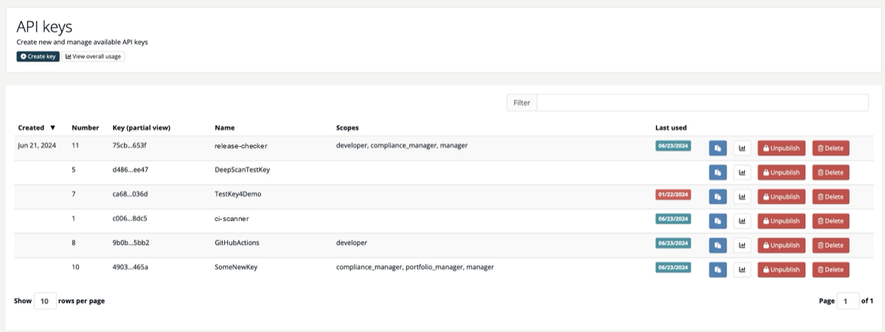

# API keys

> [!NOTE]
> **Required role:** `account_admin` for company API keys. Every user can create personal access keys in the [profile](../08-personal/03-profile.md).

API keys let scanners, CI/CD pipelines and integrations call the [REST API](../09-rest-api/index.md) without a login. Each key carries a name and a scope that limits what it may do.

Open **Administration → API keys**. The page **Scanners & API keys** opens with a card for each key type:

| Card | What it manages |
|---|---|
| **API keys** | Standard keys for the REST API (this page). |
| **Release keys** | Keys that publish the documents of one approved release. See [Release keys](04b-release-keys.md). |
| **CSAF feed keys** | TLP-scoped keys for the CSAF document feed. Shown only if your account has the CSAF feature. See [CSAF](../04-outbound/04-csaf.md). |

Select **API keys** to see the key list. To check how often keys are used, see [API usage](04a-api-usage.md).

## Create a key

1. Select **Create key**.
2. Enter a **Name**. Pick a name that tells you who or what uses the key, for example the pipeline or the cost centre. The name appears in the key list and in the [usage statistics](04a-api-usage.md).
3. Select one or more **Scopes**.
4. Select **Create**.

The new key starts unpublished. Select **Publish** in its row to activate it. The full key is never displayed: the list shows only a partial view, and the clipboard button copies the complete key once the key is published.

> [!NOTE]
> The create dialog always requires at least one scope.

## Scopes

A scope is a role name, for example `developer`, `manager` or `compliance_manager`. A key may call an operation only if at least one of its scopes is allowed to. A call outside the scope fails with `403`.

Pick the smallest scope that does the job. A scanner that only submits scans needs `developer`, not `account_admin`. [API scopes](../10-roles-permissions/09-api-scopes.md) lists which scope may call which operation.

### Change a scope

A scope cannot be changed after the key is created. To give a pipeline a different scope:

1. Create a new key with the same name and the new scope.
2. Replace the old key in the pipeline or integration.
3. Unpublish and delete the old key.

The new key is a different key, so the secret changes and every place that uses it must be updated. Because the name is the same, the logs and the [usage statistics](04a-api-usage.md) still show the activity under that name.

> [!TIP]
> If you widen a scope, make that visible in the name of the successor, for example `ci-scanner` → `ci-scanner-manager`. A reader of the logs then sees at a glance that the permissions changed.

## Publish and unpublish

An unpublished key is switched off: requests that use it are rejected with `403`. You can publish it again at any time.

| Action | Effect |
|---|---|
| **Publish** | Activates the key. Needs a scope. |
| **Unpublish** | Pauses the key. The copy button is disabled while the key is unpublished. |

## Delete a key

Only an unpublished key can be deleted. Select **Delete** in its row and type the key name to confirm. Deleting cannot be undone. Requests made earlier stay in the logs under the key name, and you can create a new key with the same name (see [Change a scope](#change-a-scope)).

## Personal access keys

Every user can create a key for themselves under **Profile → Personal access keys**.

- The key takes over your roles in the current company as its scope. You cannot choose a scope.
- Only you can publish, unpublish or copy it. It also appears in the company key list, marked in the **PAK** column.
- The profile offers publish, unpublish and copy, but no delete.

> [!TIP]
> Use a company API key, not a personal one, for pipelines that run for a long time. A personal key follows your own roles and account.

## Related

- [API usage](04a-api-usage.md)
- [Release keys](04b-release-keys.md)
- [REST API authentication](../09-rest-api/01-authentication.md)
- [API scopes](../10-roles-permissions/09-api-scopes.md)
