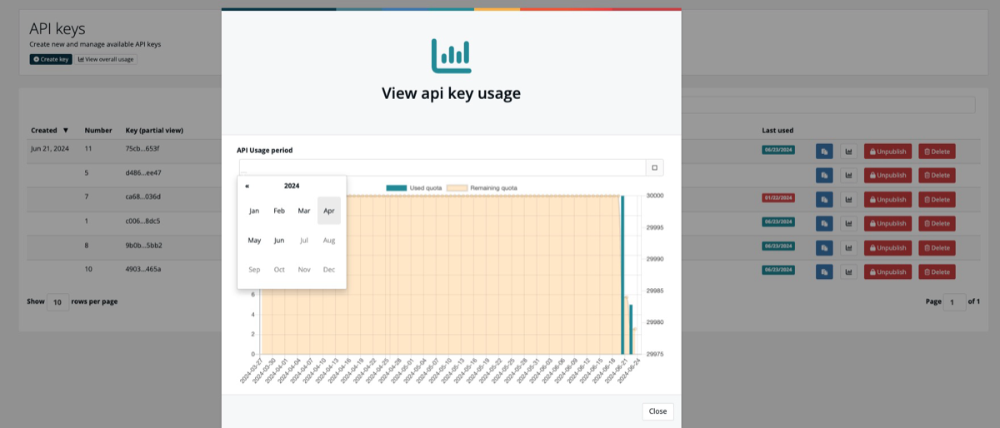
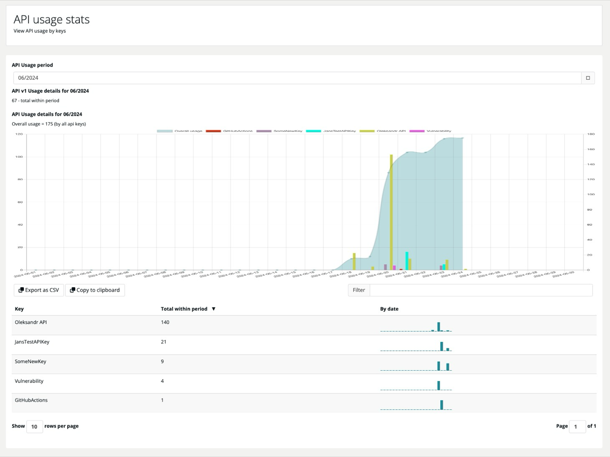

# API usage

> [!NOTE]
> **Required role:** `account_admin`

***TrustSource*** records how often each API key is used. Use the statistics to find out which pipeline causes how many calls, and to spot keys nobody uses any more.

> [!NOTE]
> The statistics may not include the most recent requests. Expect the latest calls to show up with a delay.

## Usage of one key

In **Administration → API keys → API keys**, each row has a small chart button . It opens **API key usage statistics** for that key.

- Choose the **API usage period** to switch the month.
- The bars show the **used quota** per day.
- The shaded area shows the **remaining quota**.

The button stays disabled for keys that have no usage record yet.

## Usage of all keys

Select **View overall usage** in the page header. The button appears once your account has a usage plan.

The page shows:

- **Overall usage**: the total number of calls of all keys in the selected month.
- A chart with the calls per day and key.
- A table with the **total within the period** and a small bar chart **by date** for each key.

Use the **Filter** field above the table to find a key by name. Select the column heading to sort.

### Export

- **Export as CSV** downloads a file with one row per key: key name, total within the month and the counts by date. Fields are separated by semicolons.
- **Copy to clipboard** copies the same data, so you can paste it into a spreadsheet.

## Related

- [API keys](04-api-keys.md)
- [REST API: Users](../09-rest-api/endpoints/users.md) — `GET /core/users/usage` returns usage over the API
