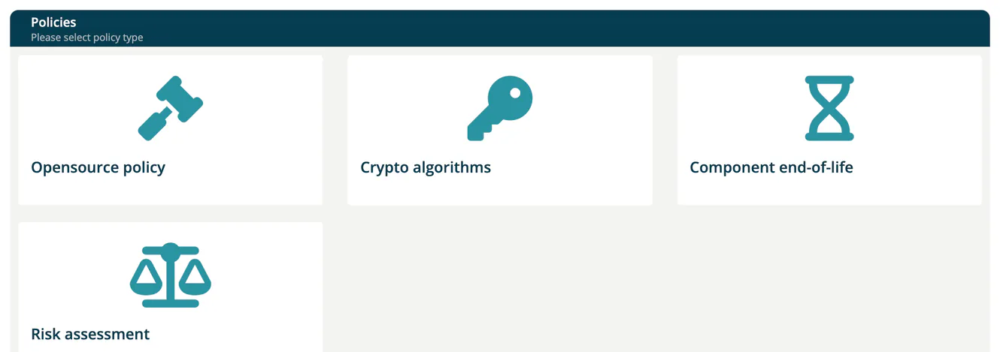

# Policies

> [!NOTE]
> **Required role:** `account_admin`, `company_security_manager` or `compliance_manager`. The **Opensource policy** card is shown to `compliance_manager` only; **Risk assessment** only with the `risks` feature.

**Administration → Policies** collects the company-wide rules that projects and modules are measured against. The page shows up to four cards.

| Card | What it holds |
|---|---|
| **Opensource policy** | The policy documents your company publishes to its users. |
| **Crypto algorithms** | Algorithms your company denies. |
| **Component end-of-life** | The company default for end-of-life monitoring. |
| **Risk assessment** | The scales and decision limits your risks are assessed on. Needs the `risks` feature. |

## Opensource policy

Compliance managers upload the policy document here. Users then see the active policy under **Knowledge → Open source policy** (see [Open Source Policy](../05-knowledge/07-open-source-policy.md)).

1. Select **Upload new policy** and enter the **Policy name**.
2. Choose the **Document** (PDF or PPTX, up to 20 MB).
3. Under **Notify users**, choose the roles that must be informed about the policy.
4. Add a **Summary of changes** and select **Create Policy**.
5. The new policy is not active yet. Click its row to open **Update policy information**, switch **Active** on and select **Submit**.

Activating a policy sets its **Active from** date to today and deactivates the policy that was active before. Only one policy is active at a time. Switching **Active** off removes the date again.

The list shows **Active**, **Active from**, **Created**, **Updated**, **Policy name**, **Document**, **Notify**, **Presented**, **Viewed** and **Confirmed**, so you can follow who has read and confirmed the policy. A policy name must be unique.

## Crypto algorithms

Lists the algorithms your company denies. Each row shows **Created**, **Key**, **Strength**, **Comment** and **Added by**. Select a row to see where the algorithm is used.

To add one, select **Deny algorithm** and fill in **Name**, **Strength** (a numeric value such as `256` or `1024`) and an optional **Comment**. The trash button in a row removes the entry.

## Component end-of-life

Switch **Enable end-of-life analysis for all modules** on to monitor end-of-life dates company-wide. A confirmation asks you to approve the change, because it affects all future analyses.

While the switch is on, two sliders under **End-of-life thresholds** set the thresholds in months, from 0 to 24 (the sliders show values such as `12m`). Select **Update** to save them.

| Slider | Meaning |
|---|---|
| **Warning threshold** | The level at which an end-of-life component is reported as a warning. |
| **Violation threshold** | The level at which an end-of-life component is reported as a violation. |

The value `0` shows "no monitoring". The violation threshold may not be larger than the warning threshold. Projects and modules can set their own values; see [End-of-life (Project)](../03-internal/01-projects/settings/06-end-of-life.md).

## Risk assessment

The **Risk assessment** card opens the company's **risk assessment scheme**: your own impact classes, value scale (business value and exposure factor), annual-rate-of-occurrence scale and three decision thresholds (*Decision required from*, *Acceptance not permitted from*, *Maximum temporary exception*).

- Without a scheme of your own, the built-in default applies and nothing changes.
- Only `account_admin`, `compliance_manager` and `company_security_manager` can change it; other roles see it read-only.
- Without the `risks` feature the page only says that risk management is not part of the plan.
- Projects and modules can override parts of the scheme on their **CIA** tab.

Step by step instructions, the entry rules and the effect of each threshold are in [Risk Assessment Scheme](../03-internal/05-risks/07-risk-assessment-scheme.md).

## Related

- [Settings](02-settings.md)
- [Open Source Policy](../05-knowledge/07-open-source-policy.md)
- [Algorithms](../05-knowledge/05-algorithms.md)
- [Risks](../03-internal/05-risks/index.md) - where the scheme is applied
