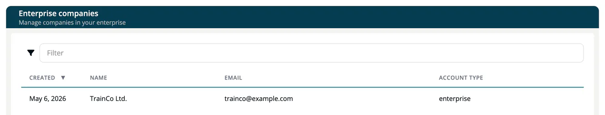

# Enterprise Companies

> [!NOTE]
> **Required role:** `enterprise_admin`
> **Required account type:** Enterprise or Medical

If your organization runs several companies in one enterprise group, the enterprise admin sees them under **Administration → Enterprise Companies**. The page is a read-only overview of the member companies and their API usage.

## The company list

The table shows **Created**, **Name**, **Email** and **Account type** for every company in your group. Use the filter to search and select a row to open the company.

## Company details

The detail page repeats the **Account type** and, when the company has a usage plan, shows its API usage:

1. Choose the month in the **API Usage period** selector.
2. Read the charts and the **Overall usage** across all API keys of the company.
3. Use **Export as CSV** or **Copy to clipboard** to take the numbers with you.

The numbers come from the last update and may not include the most recent API requests.

> [!NOTE]
> The list returns only the data needed for display. Credentials and keys of member companies are not exposed to the enterprise admin.

To switch into another company of your group, use the company switcher in the sidebar. If the target company enforces corporate login, the switcher warns that you cannot sign in again without an active IDM account.

## Related

- [API Usage](04a-api-usage.md)
- [Account Types](../00-getting-started/02-account-types.md)
