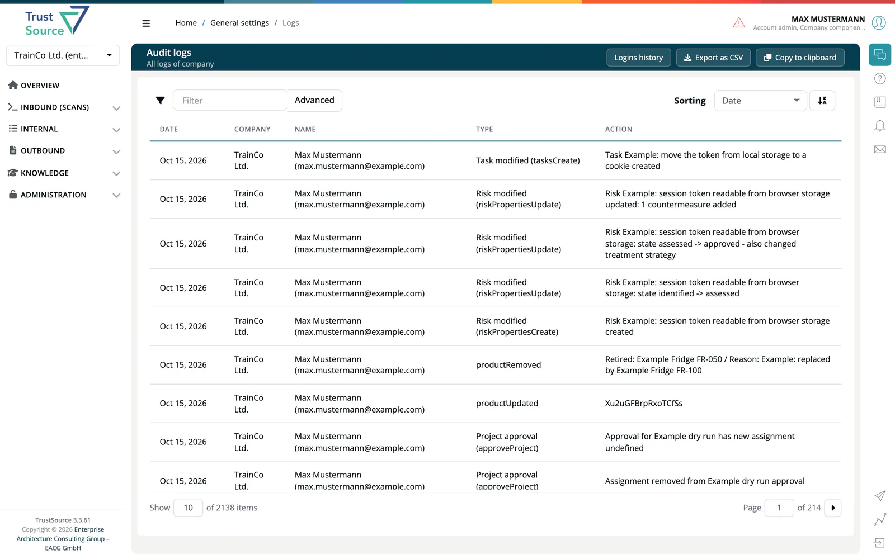

# Audit Logs

> [!NOTE]
> **Required role:** `account_admin`

The **Audit logs** page is your company's audit trail: who did what, when, and to which object. It lists every recorded action of every user and of API keys, newest first.

Open **Administration → Audit logs** in the menu, or click **View all logs** on the dashboard's activity panel.

## Read the table

| Column | Meaning |
|---|---|
| **Date** | When the action happened. |
| **Company** | Your company. |
| **Name** | The user, or the name of the API key, or *unknown* if the actor no longer exists. |
| **Type** | A group label followed by the event key, for example *Risk modified (riskPropertiesUpdate)*. |
| **Action** | A plain sentence describing the change. |

## Find an entry

- Type in the **Filter** box to search the user name, the event label and the message at once.
- Click **Advanced** to combine filters: **User name**, **Event**, **Message** and **Event type**. Event type is a list of all event keys, which is the most exact way to narrow down. A badge on the button shows how many filters are active. **Clear** removes them.

## Export

- **Export as CSV** downloads the entries that match the current filter and sorting, as `export_logs_<date>_<user>.csv` with the columns Date, Name, Type and Action. The delimiter is a semicolon. Cells that start with `=`, `+`, `-` or `@` are written as text, so a spreadsheet never runs them as a formula.
- **Copy to clipboard** copies the same table.

## What is logged

The Type filter groups events by label. The most useful ones:

| Group | Examples |
|---|---|
| **Test imported** | Every SARIF import: who uploaded it (a user, or the API key by name), the module and project, how many runs were stored or skipped, and the tools. |
| **Risk modified** | A risk was created, updated or removed, including by imports and by the deadline sweep. State changes read *Risk ...: state a -> b*. Also: switching **Create risks from SARIF weaknesses (CWE)**, **from vulnerabilities (CVE)** or **from OBOM findings** on or off, with old and new value, whether from the UI or the Projects API. |
| **Risk assessment scheme modified** | The company, project or module scheme changed. |
| **Task modified** | A risk task was created, changed or removed. |
| **Quality settings modified** | A test tool was added to, changed on or removed from a company, project or module. The entry names the setting. |
| **Rules modified** | A CWE assignment was assigned or withdrawn on a scanning rule; a withdrawal names the old value. |
| **Scan added**, **Scan processed**, **Scan deleted** | Dependency scans. Dependencies skipped during processing are recorded here. |
| **Project modified**, **Module modified** | Create, delete and settings changes. |
| **Approval created**, **Project approval**, **Module approval** | The approval workflow. |
| **User modified**, **Account modified**, **Auth updated** | Invitations, roles, company and sign-in settings. |
| **Policy modified**, **Allow/deny-list modified**, **License modified** | Policies and lists. |
| **CSAF created / updated / published / checked** | CSAF documents. |
| **Integration modified**, **Webhook created** | Integration settings. |
| **API activity recorded** | API key and release-key use. |

Some imports and checks are written as a single entry, even for hundreds of changes: a settings change on a very large list adds one summary entry, and a SARIF import that exceeds the risk register limits adds one entry that says how many weaknesses were not tracked. See [Automatic Risks](../03-internal/05-risks/08-automatic-risks.md#sarif-weaknesses-cwe).

## Logins

User logins are not part of this table. Click **Logins history** at the top right to open the [Login History](09-login-history.md).

## Related

- [Login History](09-login-history.md) - sign-ins and users who have not logged in
- [Risk History](../03-internal/05-risks/09-risk-history.md) - the full old and new values of a risk
- [SW Quality Scans](../02-inbound/04-sw-quality-scans.md) - what a SARIF import records
