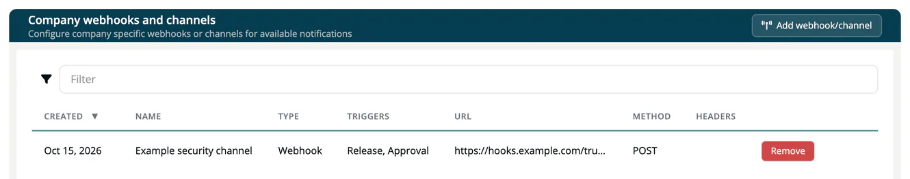

# Webhooks and channels

> [!NOTE]
> **Required role:** `account_admin`, `manager` or `compliance_manager`. Only these roles can see and create webhooks, because URLs and header values can act as credentials. The **Integrations** page itself is shown to account admins; managers and compliance managers use a project's **Webhooks and Channels** tab, or open the company page at `/settings/company/webhooks`.

A **webhook** or **channel** sends a message to another system when something happens in ***TrustSource***: a Slack channel, a Microsoft Teams channel or any HTTP endpoint such as your ticketing or chat bridge.

There are two places to manage them:

- **Company-wide:** **Administration → Integrations → Webhooks and Channels** ("Company webhooks and channels"). Receivers created here apply to every project in your company.
- **Per project:** the **Webhooks and Channels** tab in the project settings. Receivers created there apply to that project only.

## Add a webhook or channel

1. Select **Add webhook/channel**.
2. Enter a **Name**, for example "Security channel".
3. Select one or more **Trigger** values.
4. Choose the **Type** and fill in the fields below it.
5. Select **Add webhook**.

### Types

| Type | Fields | Notes |
|---|---|---|
| **Webhook** | **Method** (POST, PUT, PATCH, DELETE, GET), **Url**, optional **Headers** | Enter headers as `Key: value` pairs separated by `;`, for example `Authorization: Bearer abc123; X-Team: security`. |
| **Microsoft Teams Workflow** | **"Workflow" url** of a "Post to a channel when a webhook request is received" workflow | |
| **Slack** | **"Incoming Webhook" url** from your Slack app | |
| **Microsoft Teams O365 (Deprecated - October 1st, 2024)** | **"Incoming Webhook" url** of a Teams connector | Use the workflow type instead. |
| **Gitter (Under development)** | | Cannot be selected. |

### Triggers

| Trigger | Sends a message when |
|---|---|
| **Analysis** | A module analysis has finished. |
| **Release** | The documents of an approved release are released. |
| **Vulnerability** | New vulnerabilities match a component: one message per component. |
| **Vulnerabilities by module** | New vulnerabilities match: one message per module. |
| **Vulnerabilities by project** | New vulnerabilities match: one message per project. |
| **Vulnerabilities in releases** | New vulnerabilities match the frozen components of a release: one message per release. |
| **Approval** | An approval is approved or rejected. |
| **Task** | An issue is created in Jira, TFS or GitHub. |

You can select several triggers per receiver. Choosing two vulnerability triggers delivers the same findings twice, at two levels of detail.

## Vulnerability alerts

The four vulnerability triggers turn a webhook into an alert channel for newly matched CVEs. The trigger you choose is the whole configuration. A receiver on the company page watches all projects; a receiver on a project's tab watches that project.

- Alerts name where an affected component is used and which versions it can be upgraded to. Slack and Teams messages do not carry this extra detail.
- Only new matches are sent. Existing findings are not replayed when you add a receiver.
- **Vulnerabilities by module** is not rendered by Slack and Teams. Use a **Webhook** type receiver for it.

> [!WARNING]
> Review your receivers before you turn alerts on. A very busy day for new CVEs can produce one large message, and some receivers reject messages above a size limit.

## The list and removal

The list shows **Created**, **Name**, **Type**, **Triggers**, **URL**, **Method** and the number of **Headers**. Select **Remove** in a row to delete a receiver.

> [!NOTE]
> Webhook URLs must be public. Addresses that point to a private, loopback or cloud-metadata destination are refused when you save with "Invalid integration URL".

## Related

- [Integrations](08-integrations.md)
- [Post-release vulnerabilities](../03-internal/06-approvals/06-post-release-vulnerabilities.md)
