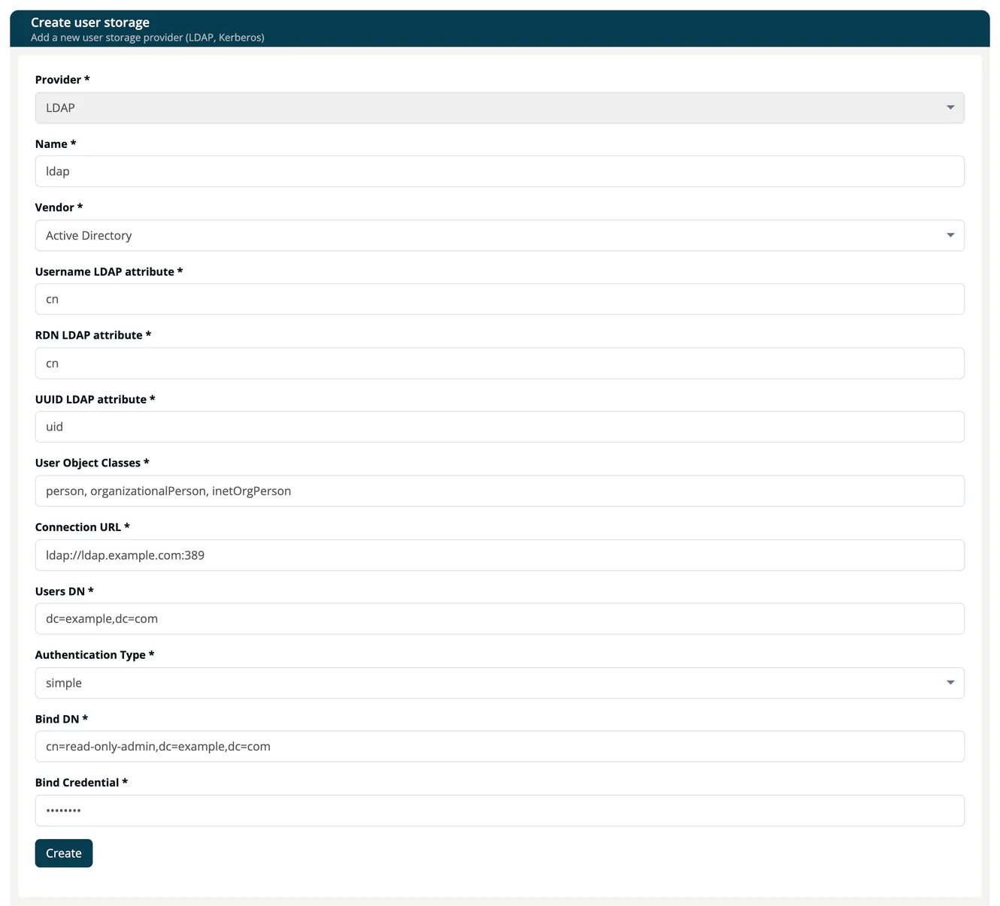

# User Storage

> [!NOTE]
> **Required role:** `account_admin`
> **Required account type:** Enterprise or Medical

A **user storage** connects your user directory to ***TrustSource***, so your people sign in with the accounts they already have. The list shows each storage with its **Name** and **Provider**. Select **Edit** to open one, or **Create new user storage** to add one.

## Create a user storage

The provider is LDAP. The create form shows only the required fields (marked with an asterisk) and is pre-filled with example values; replace them with your own.

| Field | Description |
|---|---|
| **Name*** | A name for this connection. |
| **Enabled**, **Priority** | Switch the storage on and decide its order if you have several. |
| **Import Users** | Copy users from the directory into the identity store. |
| **Edit Mode** | `READ_ONLY`, `WRITABLE` or `UNSYNCED`. |
| **Sync Registrations** | Write newly registered users back to the directory. |
| **Vendor*** | Active Directory, Red Hat Directory Server, Tivoli, Novell eDirectory or Other. |
| **Username LDAP attribute***, **RDN LDAP attribute***, **UUID LDAP attribute***, **User Object Classes*** | How users are identified in your directory. |
| **Connection URL*** | The address of your directory, for example `ldaps://ldap.acme.example:636`. |
| **Users DN*** | The place in the directory tree where your users live. |
| **Authentication Type***, **Bind DN***, **Bind Credential*** | The account used to read the directory. |
| **Custom User LDAP Filter**, **Search Scope** | Narrow down which entries count as users (**One Level** or **Subtree**). |
| **Validate Password Policy**, **Use Truststore SPI** | Password policy check and when to use the truststore (**Always**, **Only for ldaps**, **Never**). |
| **Connection Pooling**, **Connection Timeout**, **Read Timeout**, **Pagination** | Connection behavior. |
| **Full Sync Period**, **Changed Users Sync Period** | How often users are synchronized automatically. |

Select **Create** to save. The form checks the required fields. After saving, the edit page of the new storage opens; set the optional fields there.

## Maintain a user storage

On the edit page:

- **Update** saves your changes.
- **Synchronize changed users** and **Synchronize all users** import users from the directory now.
- **Remove imported** deletes the users that were imported from this storage.
- **Unlink users** detaches the imported users from this storage; they stay in the identity store.
- **Remove** deletes the storage after a confirmation.

## Related

- [Identity Integration](index.md)
- [Stored users](03-stored-users.md)
