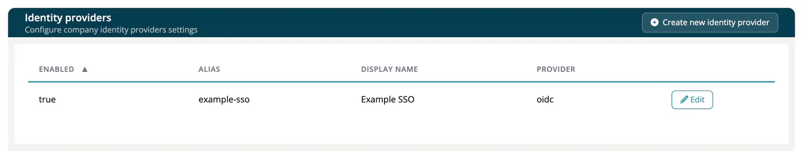

# Identity Providers

> [!NOTE]
> **Required role:** `account_admin`
> **Required account type:** Enterprise or Medical

An **identity provider** is the system your users sign in with: your SAML or OpenID Connect service or a social login. The list shows **Enabled**, **Alias**, **Display name** and **Provider**.

## Add an identity provider

1. Select **Create new identity provider**.
2. Choose the **Provider**: **SAML v2.0** or **OpenID Connect v1.0**, or a social provider such as GitHub, Google, GitLab, LinkedIn or Microsoft. A social provider you already added is not offered again.
3. Copy the **Redirect URI** that the form shows and register it at your provider.
4. Fill in the required fields that the form shows (marked with an asterisk) and select **Create**.

After saving, the edit page opens with all the fields below. Use **Update** to change the settings and **Remove** to delete the provider. The provider type cannot be changed.

## Fields shared by all providers

| Field | Description |
|---|---|
| **Alias*** | The short name of the provider. For a social provider it defaults to the provider name. |
| **Display name** | The name users see on the login page. |
| **Enabled** | Switches the provider on or off. |
| **Store Tokens**, **Stored Tokens Readable** | Keep the provider's tokens and allow reading them. |
| **Trust Email** | Treat the email address from the provider as verified. |
| **Account Linking Only** | Allow the provider only to link existing accounts. |
| **Hide on Login Page** | Do not show a button for this provider. |
| **GUI order** | Position among several providers. |
| **First Login Flow**, **Post Login Flow** | The authentication flow that runs for a new user, and one afterwards. |
| **Sync Mode** | How user data is updated on later logins: `import`, `legacy` or `force`. |

## SAML 2.0

| Field | Description |
|---|---|
| **Single Sign-On Service URL*** | The login address of your SAML service. |
| **Single Logout Service URL**, **Backchannel Logout** | Logout handling. |
| **NameID Policy Format** | How users are named: Persistent, Email, Kerberos, X.509 Subject Name, Windows Domain Qualified Name or Unspecified. |
| **HTTP-POST Binding Response**, **...for AuthnRequest**, **...Logout** | Use HTTP-POST bindings. |
| **Want AuthnRequests Signed**, **Want Assertions Signed**, **Want Assertions Encrypted** | Signing and encryption requirements. |
| **Signature Algorithm**, **SAML Signature Key Name** | `RSA_SHA1`, `RSA_SHA256`, `RSA_SHA512` or `DSA_SHA1`; key name `NONE`, `KEY_ID` or `CERT_SUBJECT`. |
| **Force Authentication** | Ask users to sign in again. |
| **Validate Signature**, **Validating X509 Certificates** | Check the provider's signature against the certificate you paste. |

## OpenID Connect 1.0

| Field | Description |
|---|---|
| **Authorization URL***, **Token URL*** | The endpoints of your provider. |
| **Logout URL**, **Backchannel Logout**, **User Info URL**, **Disable User Info** | Logout and user info handling. |
| **Client Authentication*** | How the client proves itself: secret sent as post, secret sent as basic auth, secret as JWT or JWT signed with private key. |
| **Client ID***, **Client Secret*** | The client registered at your provider. |
| **Issuer**, **Default Scopes**, **Prompt** | Issuer, scopes and prompt behavior (`unspecified`, `none`, `consent`, `login`, `select_account`). |
| **Validate Signatures**, **Use JWKS URL**, **Validating Public Key**, **Validating Public Key Id**, **Allowed clock skew** | Token validation. |
| **Pass login_hint**, **Forwarded Query Parameters** | Pass data to the provider. |

Social providers need the **Client ID*** and **Client Secret*** you get from the provider, and optionally a **Default Scope**.

## Related

- [Identity Integration](index.md)
- [SSO / Auth Troubleshooting](../11-troubleshooting-faq/05-sso-troubleshooting.md)
