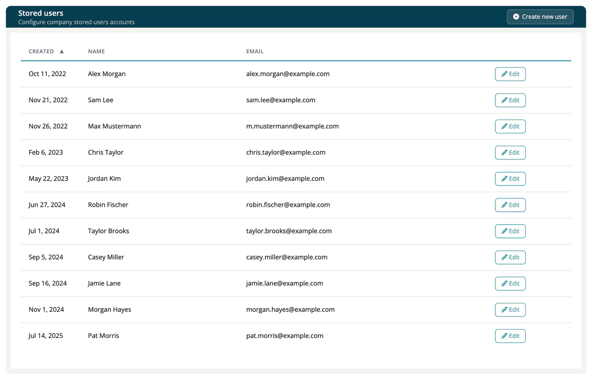

# Stored Users

> [!NOTE]
> **Required role:** `account_admin`
> **Required account type:** Enterprise or Medical

**Stored users** are accounts that live in your identity store itself, not in an external directory. Use them for people who have no account in your directory. The list shows **Created**, **Name** and **Email**.

## Create a user

1. Select **Create new user**.
2. Enter the **Username** and **Email**. The create form shows only these required fields.
3. Select **Create**. The edit page of the new user opens, where you can set **Enabled** and **Name**.

A new user is enabled.

| Field | Description |
|---|---|
| **Enabled** | Lets the user sign in. |
| **Username*** | The login name. It cannot be changed later. |
| **Email*** | The email address of the user. |
| **Name** | The display name. |

## Maintain a user

Select **Edit** in a row. Besides **Update** and **Remove** (with confirmation), the edit page can send the user an email that asks for an action:

| Button | What the user is asked to do |
|---|---|
| **Request email verification** | Verify the email address. |
| **Request profile update** | Update the profile data. |
| **Request password change** | Choose a new password. |
| **Request configure OTP** | Set up a one-time password. |

## Related

- [Identity Integration](index.md) - how users sign in and receive roles
- [User Storage](01-user-storage.md)
