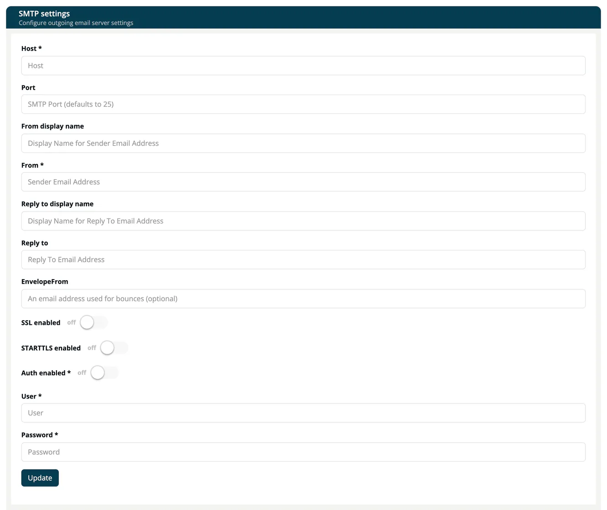

# SMTP Settings

> [!NOTE]
> **Required role:** `account_admin`
> **Required account type:** Enterprise or Medical

SMTP settings define the mail server that your identity store uses for its own emails, for example verification and password reset mails. Select **Update** to save.

| Field | Description |
|---|---|
| **Host*** | The address of your mail server. |
| **Port** | The port of the mail server. The default is 25. |
| **From display name**, **From*** | Name and address that appear as sender. |
| **Reply to display name**, **Reply to** | Name and address for replies. |
| **EnvelopeFrom** | Address for bounces (optional). |
| **SSL enabled**, **STARTTLS enabled** | How the connection to the mail server is encrypted. |
| **Auth enabled*** | Switch on when the server needs a login. |
| **User***, **Password*** | The login for the mail server. |

The form marks **Auth enabled**, **User** and **Password** as required, in addition to **Host** and **From**.

## Related

- [Login settings](04-login-settings.md)
- [Identity Integration](index.md)
