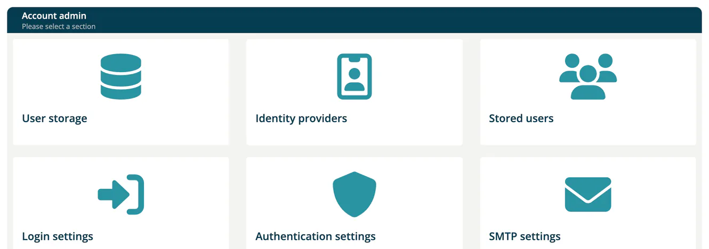

# Identity Integration

> [!NOTE]
> **Required role:** `account_admin`
> **Required account type:** Enterprise or Medical. The menu entry **Administration → Identity Integration** is only shown for these account types.

Identity Integration lets your company sign in with its own identity systems instead of ***TrustSource*** passwords: your directory (LDAP), a SAML or OpenID Connect provider, or a social login. The page ("Account admin") shows six cards.

| Card | What you do there |
|---|---|
| [User storage](01-user-storage.md) | Connect an LDAP directory and synchronize its users. |
| [Identity providers](02-identity-providers.md) | Add SAML, OpenID Connect or social sign-in providers. |
| [Stored users](03-stored-users.md) | Create and manage users that live in the identity store. |
| [Login settings](04-login-settings.md) | Registration, password reset, "Remember me" and SSL requirements. |
| [Authentication settings](05-authentication-settings.md) | The steps of the browser login flow. |
| [SMTP settings](06-smtp-settings.md) | The mail server for emails that the identity store sends. |

## Before you start

Your account must be enabled for corporate login by ***TrustSource***. If it is not, each page shows "Sorry, your account has not yet been enabled to activate an IDP". Write to [support@trustsource.io](mailto:support@trustsource.io) and ask them to enable the feature.

## How users sign in

Users open the login page and choose **Corporate login**. They enter the name of your company and select **Login**. The box accepts the company name, the company id or the realm name of your company, and then redirects to your identity provider.

When a user signs in for the first time, the roles that your identity provider sends are applied if the user has no roles in your company yet. Afterwards an account admin can change roles in [User Management](../06-administration/03-user-management.md).

> [!NOTE]
> If your company enforces corporate login, password and social login are no longer offered. Roles are then taken from the identity provider on every login, and **User Management** is hidden. A company switcher warns before you switch into such a company.

## Related

- [First login](../00-getting-started/03-first-login.md)
- [SSO / Auth Troubleshooting](../11-troubleshooting-faq/05-sso-troubleshooting.md)
