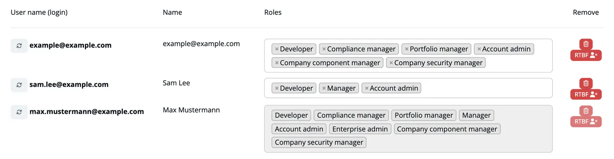

# The 8 Roles

***TrustSource*** knows eight roles that account admins can assign. Roles are set per company, and a user can hold several at once; the rights add up. One more role is bound to a licence, see [Licence-bound role](#licence-bound-role).

| Role | Key | Focus |
|---|---|---|
| **Developer** | `developer` | Works with scans and modules. Edits module settings such as tags, thresholds, allow/deny lists and CIA. |
| **Compliance manager** | `compliance_manager` | Owns the compliance workflow: approvals, allow/deny lists and their approval, outbound documents, license-related company settings and policies. |
| **Portfolio manager** | `portfolio_manager` | Organizes the portfolio: assigns the default project manager and default compliance manager, maintains tags and capabilities. |
| **Manager** | `manager` | Leads projects: approvals, tags, webhooks, and broad rights on the projects and modules they manage. |
| **Account admin** | `account_admin` | Administers the company: users, integrations, API keys, policies, billing and audit logs. |
| **Enterprise admin** | `enterprise_admin` | Administers an enterprise group: account and integrations, and the list of member companies. |
| **Company component manager** | `company_component_manager` | Maintains company-wide component lists and manual vulnerabilities. |
| **Company security manager** | `company_security_manager` | Maintains security settings: CIA and capabilities, encryption, private algorithms, crypto policies and manual vulnerabilities. |

For what each role sees and can change, see [Functions by Role](05-functions-by-role.md) and [Functions by Area](04-functions-by-area.md).

## Assigning roles

- **Who:** account admins use **Administration → User Management**. They pick roles when they invite a user, and can change them later in the user list. See [User Management](../06-administration/03-user-management.md).
- **At least one role.** A user must keep one role; remove the user instead of clearing all roles.
- **Your own roles** cannot be changed in the list.
- **New companies.** When someone registers a new company, that person receives the roles Developer, Compliance manager, Portfolio manager, Manager, Account admin, Company component manager and Company security manager. Enterprise admin is not part of the default.
- **Corporate login.** With an identity provider, the roles come from the provider at the first login. If your company enforces corporate login, they are taken from the provider at every login. See [Identity Integration](../07-auth-sso/index.md).

> [!WARNING]
> Ticking every role for one user gives that user all privileges. The app shows a warning when you do this, because it overrules the idea that compliance duties are shared between people.

## Licence-bound role

**CVD Coordinator** (`cvd_coordinator`) requires the `cvdself` license. It is assignable only in companies that hold the license, carries no permissions in the app and is passed on to the CVD service as a role claim. If the license is removed, the role stops taking effect.

## Related

- [Permission Model](03-permission-model.md)
- [Roles & Licenses Cheat Sheet](../00-getting-started/06-roles-licenses-cheatsheet.md)
