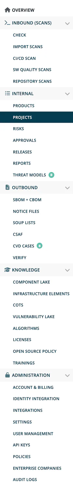

# Functions by Area

Which role sees which part of ***TrustSource***, grouped by the sections of the left navigation. The tables list menu visibility and page access. For field-level rights inside project and module settings, see the [Settings Permission Matrix](06-settings-permission-matrix.md).

## How access works

- **Menu section first.** A menu entry only appears when its section is visible to you, then when your role matches the entry. For example, **Repository Scans** sits in Inbound, but is shown only to account admins, company component managers, compliance managers and managers.
- **OR-aggregation.** If any of your roles grants access, you have it. See [Permission Model](03-permission-model.md).
- **License flags and account types** hide entries completely. See [License Features](07-license-features.md) and [Account Types](08-account-types.md).
- **Direct links.** Several pages also check your role when you open their address and show an "access denied" page otherwise.

Role abbreviations: **dev** developer, **cm** compliance manager, **pm** portfolio manager, **mgr** manager, **aa** account admin, **ea** enterprise admin, **ccm** company component manager, **csm** company security manager.

## Overview and Knowledge

Visible to every signed-in user.

| Entry | Notes |
|---|---|
| Overview | The dashboard. |
| Component Lake, Infrastructure Elements, COTS, Vulnerability Lake, Algorithms, Licenses, Open source policy | All roles. |
| Trainings | Opens your company's trainings address when the account admin entered one, see [Company details](../06-administration/02a-company-details.md). |

## Inbound (Scans)

Section visible to: **dev, cm, mgr, aa, ccm**.

| Entry | Visible to | Requirement |
|---|---|---|
| Check, Import Scans, CI/CD Scan | dev, cm, mgr, aa | - |
| Repository Scans | aa, ccm, cm, mgr | - |
| SW Quality Scans | dev, cm, mgr, aa | License `sarif` |
| Mass Scans (BETA) | cm, mgr, aa | Account type Enterprise |

## Internal

Section visible to: **dev, cm, mgr, aa**.

| Entry | Visible to | Requirement |
|---|---|---|
| Projects, Reports, Releases | dev, cm, mgr, aa | - |
| Products | dev, cm, mgr, aa | License `products` |
| Risks | dev, cm, mgr, aa | License `risks` |
| Threat Models (BETA) | dev, cm, mgr, aa | License `threat` |
| Approvals | cm, mgr | - |

The analysis views of a module (dependencies, graphs, vulnerabilities, viability, licenses) are open to dev, mgr, cm and aa.

## Outbound

Section visible to: **cm, mgr, aa**.

| Entry | Requirement |
|---|---|
| SBOM + CBOM, Notice Files, Verify | - |
| SOUP Lists | Plan feature `soup_report` or license `medical` |
| CSAF | License `csaf` |
| CVD cases (BETA) | License `psirt` |

## Administration

| Entry | Visible to | Requirement |
|---|---|---|
| Account & Billing | aa, ea | - |
| Identity Integration | aa | Account type Enterprise or Medical |
| Integrations | aa, ea | - |
| Settings | aa, cm, csm, ccm, pm, mgr | Cards depend on role, see below |
| User Management | aa | Hidden when corporate login is enforced |
| API keys | aa, mgr, cm, csm | Cards: API keys aa; Release keys aa, mgr, cm; CSAF feed keys aa, csm (license `csaf`) |
| Policies | aa, csm, cm | The **Opensource policy** card is shown to cm only; **Risk assessment** only with license `risks`. |
| Enterprise Companies | ea | Account type Enterprise or Medical |
| Audit logs | aa | Login history is opened from here, also open to mgr and cm |

### Settings cards

| Card | Visible to |
|---|---|
| General info | aa |
| FOSS liaison, Written offer, License allow/deny, Private licenses | aa, cm |
| PSIRT contacts, Private algorithms | aa, csm |
| Component allow/deny | aa, cm, csm, ccm |
| Encryption, Quality | aa, cm, csm |
| Company tags | aa, pm, mgr, csm, cm |
| Legal templates | aa, cm |
| Manual vulnerability | aa, csm, ccm |

Private licenses are shown for Enterprise and Medical accounts only. Some forms behind a card are restricted further; see [Settings](../06-administration/02-settings.md).

## Pages with their own role check

| Page | Role |
|---|---|
| Critical components report | `company_component_manager` |
| Vulnerability activity | `company_security_manager` |

## Related

- [Functions by Role](05-functions-by-role.md)
- [Permission Model](03-permission-model.md)
