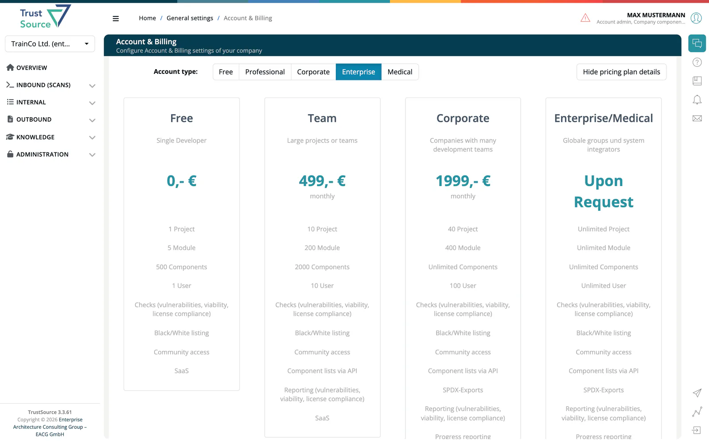

# Account Types

An **account type** (also called plan) sets the capacity of your company and a few plan features. The five account types are **Free**, **Professional**, **Corporate**, **Enterprise** and **Medical**. For the capacity table and typical use cases, see [Getting Started → Account Types](../00-getting-started/02-account-types.md).

Account types are different from [license features](07-license-features.md): a license feature is a flag provisioned for your company, while the account type comes from your plan.

## What an account type controls

**Capacity.** The plan sets the number of projects, modules, components and users. At the limit, the matching page says so. For users, the **User Management** page shows "Limit was reached" with the number of users to remove or a link to upgrade.

**Plan features.** The app checks these features against your plan:

| Plan feature | Effect |
|---|---|
| Jira integration | Enables the Jira settings under [Integrations](../06-administration/08a-issue-trackers.md). |
| GitHub integration | Enables the GitHub settings. |
| TFS integration | Enables the TFS and Azure DevOps settings. |
| LeanIX integration | Enables the [LeanIX settings](../06-administration/08b-leanix-scanoss.md). |
| Multi-Jira, multi-TFS, multi-GitHub | Lets a single project use its own issue tracker settings instead of the company settings. |
| SOUP reports | Shows **SOUP Lists** in the Outbound menu. A company with the `medical` license flag sees it as well. |

Without the plan feature, the integration pages show a note that you need a corporate account type and keep their fields disabled.

**Account type checks.** A few areas depend on the account type itself:

| Area | Account type |
|---|---|
| Identity Integration (SSO) and Enterprise Companies | Enterprise or Medical |
| Private licenses | Enterprise or Medical |
| Mass Scans | Enterprise |
| MDR/IVDR classification tabs | Medical |

## See and change your plan

Account admins and enterprise admins open **Administration → Account & Billing**. **See pricing plan details** shows the live limits and monthly price of every plan. See [Account & Billing](../06-administration/01-account-billing.md).

## Related

- [License Features](07-license-features.md)
- [Roles & Licenses Cheat Sheet](../00-getting-started/06-roles-licenses-cheatsheet.md)
