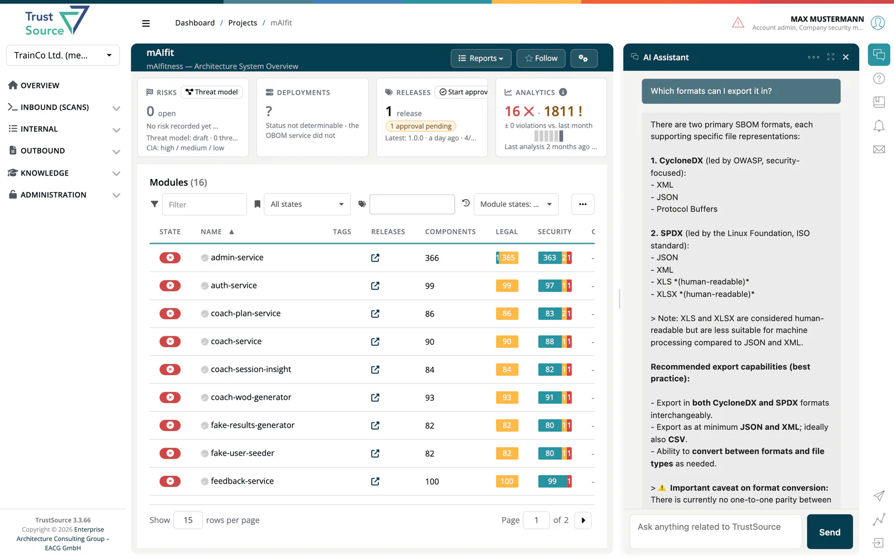
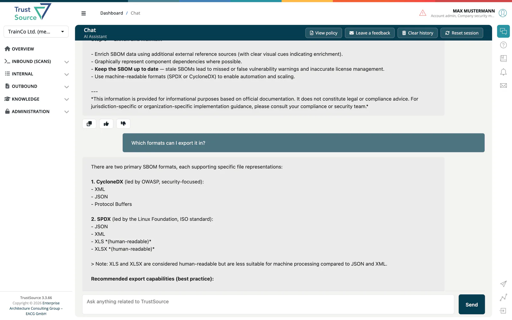

# OSCAR Chat

> [!NOTE]
> **Required license feature:** `chat`
> **Status:** Beta

***OSCAR*** is the conversational assistant inside ***TrustSource***. In the app it appears as the **AI Assistant**: the chat icon in the right bar opens it. It
answers questions about your projects, modules, components and license
findings in natural language, and helps users find their way around the
platform without having to know the underlying click-paths.

## What this capability adds

- A **chat panel** docked on the right side of any page, resizable
  between a slim companion and a wide reading column.
- A **full-page chat** mode at `/chat` for longer conversations (**Open full page** in the panel).
- **Session history**, message rating (**Like** / **Dislike**), **Copy**, **Reset session**, **Clear history** and **Leave a feedback**.
- **Context-aware answers** that pull from your account's projects and
  components, not from a generic knowledge base.

Before your first question, the assistant shows the **Chat usage policy**:
tick its three statements and select **Confirm**. In the full-page chat,
**View policy** shows the policy again.

## Editions

- **SaaS:** available with the `chat` feature flag enabled.
- **Community Edition:** **not included**. OSCAR relies on hosted
  inference infrastructure that is not part of the CE deployment.

## Related

- [Capabilities](index.md): overview of all optional capabilities.
