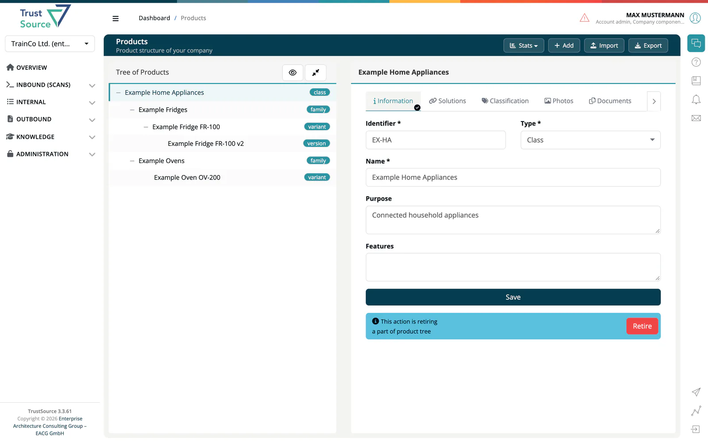
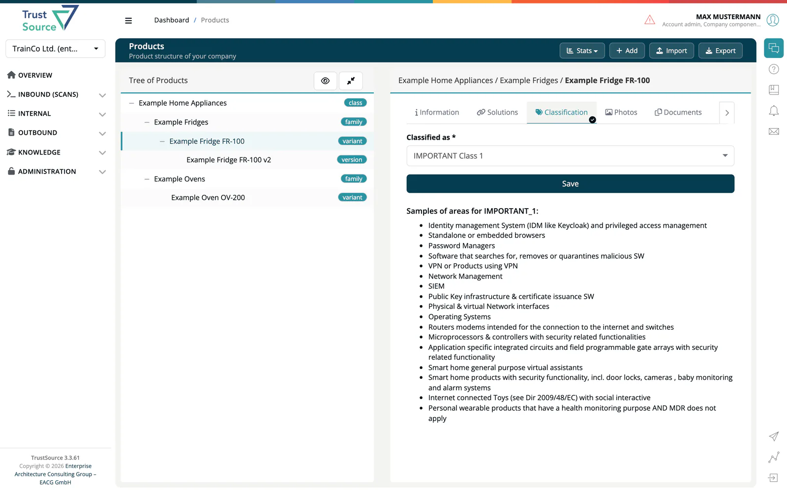

# Product

> [!NOTE]
> **Required license feature:** `products`

The **Product** capability adds a product-level abstraction above the
module/component hierarchy. Where modules describe how software is
built, products describe what is **shipped** to a customer, including
the contacts, support, classification and documentation associated with
that shipment.

## What this capability adds

- **Product registry** with the tabs Information, Solutions,
  Classification, Photos, Documents, Contacts, Support and Misuse.
- **CRA classification** of products against the EU Cyber Resilience
  Act categories (default, important class I/II, critical).
- **Release-to-product linking** so a released module's BoM, notice
  files and CSAF advisories surface in the product's customer
  documentation set.
- **Solutions** view that groups multiple modules into a single
  shippable product offering.

## Editions

- **SaaS:** available with the `products` feature flag enabled.
- **Community Edition:** products with CRA classification are included;
  see [CE vs. SaaS](../../ce/13-ce-vs-saas.md).

## Related

- [Internal → Products](../03-internal/03-products/index.md): full
  in-app reference for product creation, tabs and linking.
- [Background: Cyber Resilience Act](../../shared/background/01-cra-cyber-resilience-act.md): regulatory context for CRA classification.
