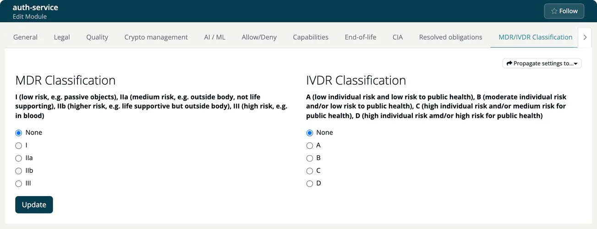

# Medical

> [!NOTE]
> **Requires:** the **Medical** account type for the MDR/IVDR classification tabs. **SOUP Lists** appear with the license feature `medical` or the plan feature `soup_report`, which the Medical plan includes.

The **Medical** capability extends ***TrustSource*** with workflows
specific to medical-device software, supporting the documentation
obligations of the EU **MDR** (Medical Device Regulation, 2017/745) and
**IVDR** (In-Vitro Diagnostic Regulation, 2017/746).

## What this capability adds

- **MDR / IVDR classification** of modules: on the **MDR/IVDR Classification**
  tab of the module settings you choose the **MDR Classification** (None, I,
  IIa, IIb, III) and the **IVDR Classification** (None, A, B, C, D).
- **SOUP lists**: generation of *Software of Unknown Provenance*
  documentation aligned with IEC 62304, listing third-party components,
  versions, licenses and known anomalies. The Reports hub also offers a
  **COTS overview** of the project's commercial components.
- A project-level **MDR/IVDR Classification** tab that holds the defaults
  for the project's modules and can import and propagate them.

## Editions

- **SaaS:** MDR/IVDR classification with the Medical account type; SOUP
  lists with the `medical` license feature or the `soup_report` plan feature.
- **Community Edition:** not included. See [CE vs. SaaS](../../ce/13-ce-vs-saas.md).

## Related

- [Outbound → SOUP Lists](../04-outbound/03-soup-lists.md): in-app reference for SOUP generation.
- [Internal → Projects → Settings → Module Classification](../03-internal/01-projects/settings/09-module-classification.md): where the MDR/IVDR defaults are configured per project.
