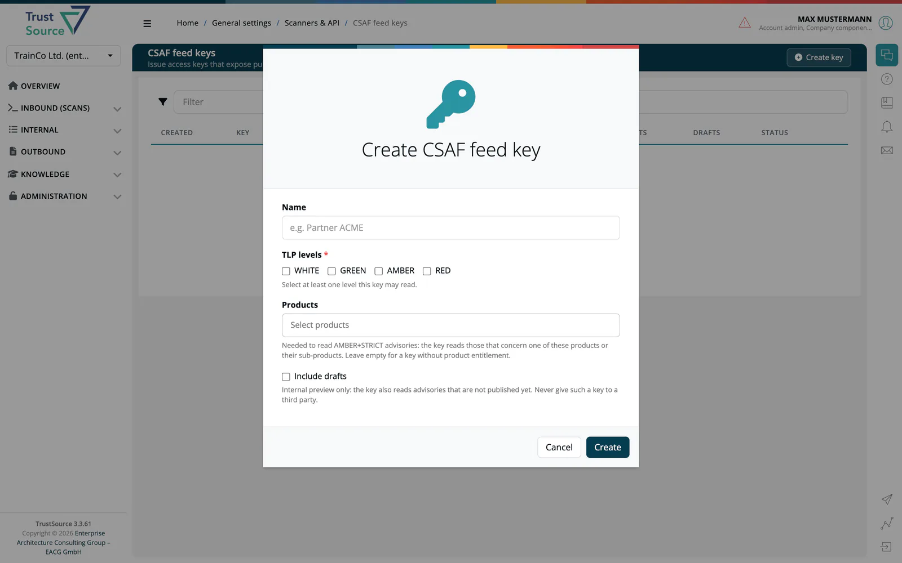

# CSAF Trusted Provider

> [!NOTE]
> **Required license feature:** `csaf`

The **CSAF Trusted Provider** capability lets your organisation publish
Common Security Advisory Framework (CSAF) advisories from
***TrustSource*** in a way that meets the requirements of the
[OASIS CSAF Trusted Provider](https://oasis-open.github.io/csaf-documentation/)
program, making your advisories machine-readable, discoverable through
the trusted-provider directory, and consumable by downstream automated
tooling.

## What this capability adds

- **CSAF document editor** with structured tabs for metadata, affected
  products, remediation steps and revision history.
- **Bulk advisory generation** from a module's SBOM, producing one CSAF
  document per known vulnerability in a single action.
- **Trusted-Provider publication pipeline**: signed JSON output,
  provider-metadata file, ROLIE feed, and TLP-aware distribution
  channels configurable per advisory.
- **TLP-based publication:** an advisory is published to the provider
  directory that matches its TLP label. Restricted advisories can be handed
  to selected recipients through access-protected feed keys, optionally
  limited to the products a recipient is entitled to (AMBER+STRICT). See
  [Outbound → CSAF Documents](../04-outbound/04-csaf.md).
- **Quality gate and history:** the CSAF 2.0 mandatory tests run before an
  advisory is published, and every published version is kept.
- Integration with the [CVD capability](05-cvd.md) so external
  vulnerability reports can flow directly into a CSAF advisory.

📸 *Screenshot: the CSAF document editor with the Metadata tab active and an advisory under preparation.*

## Editions

- **SaaS:** available with the `csaf` feature flag enabled.
- **Community Edition:** CSAF advisories and VEX are included; see
  [CE vs. SaaS](../../ce/13-ce-vs-saas.md) for the differences.

## Related

- [Outbound → CSAF Documents](../04-outbound/04-csaf.md): full in-app reference for advisory authoring.
- [Background: VEX in CSAF](../../shared/background/11-vex-csaf-vex.md): VEX use cases inside CSAF advisories.
- [CVD](05-cvd.md): intake of vulnerability reports that may end up as CSAF advisories.
