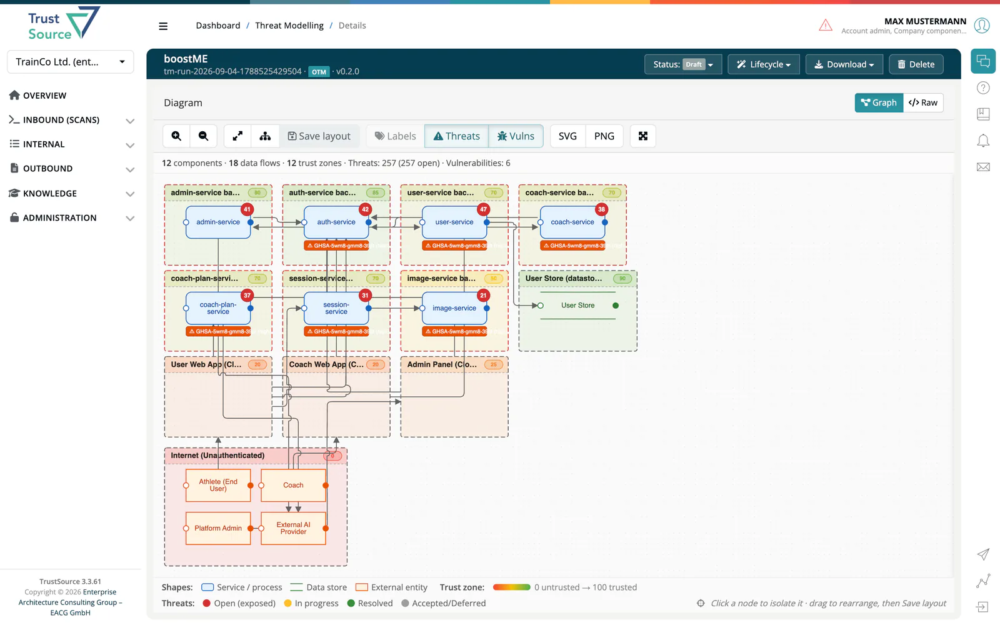
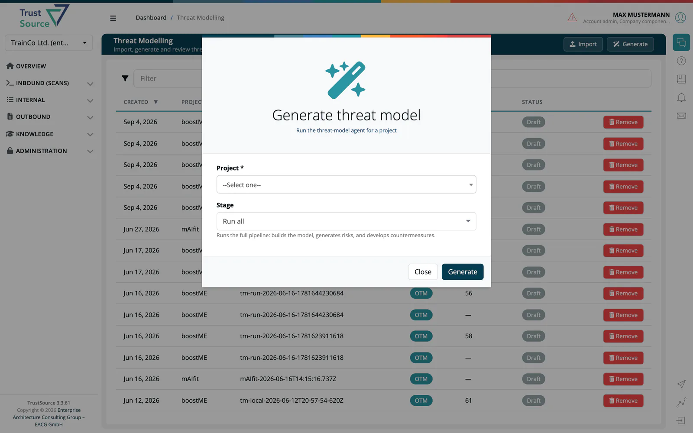

# Threat Modeling Agent (TMA)

> [!NOTE]
> **Required license feature:** `threat`
> **Service version at time of writing:** v0.45.0 (with ***TrustSource*** 3.3.87)

The **Threat Modeling Agent** is the automated engine behind every
project's threat model. It reads the current project state
(modules, vulnerabilities, existing risks and countermeasures),
compares it against the last agent run, and produces:

- **New threats** identified via STRIDE-per-Element elicitation
  (only for new or changed components; unchanged parts are not
  re-analysed).
- **Proposed countermeasures** for every new threat.
- **Baseline controls**: generic supply-chain and hygiene controls
  (pinned dependencies with a defined update cadence, a private mirror
  or registry, provenance and signature checks, SBOM generation,
  secrets in CI), listed once per project and mapped to the SSDF and
  the CRA Annex I, instead of being repeated as a threat for every
  package.
- An updated **OTM (Open Threat Model) v0.2.0** document per run,
  stored as an audit trail.

Risks that the agent creates in the risk register carry
`origin: TMA Assessment` so they are distinguishable from manually
raised risks.

## What the agent models

- **Modules** of the project are the main elements of the model. Their
  libraries are analysed as part of the module, together with the
  libraries' known vulnerabilities; a library is not a separate element.
- **Operating-system packages** of a container image or firmware module
  are grouped into one element per image ("OS packages of …").
- **Runtime infrastructure** (databases, message brokers, runtimes,
  container base images) and COTS components get their own element.
- **Datastores** come from evidence: a database, cache, search or
  message-broker driver in a module's direct dependencies (recognised
  for npm, Maven/Gradle, PyPI, Go, NuGet, Composer, Cargo, Dart/Flutter,
  Swift/CocoaPods, Conan/vcpkg and VB6), a database server in the
  project, or a statement in the project's Application goals.
  - A **self-hosted database** is modelled through its server: the
    application talks to the server component (for example a
    `mysql-server` module or a `postgres` image), the server writes to
    the datastore, and the datastore sits in the server's trust zone.
    Managed services such as S3 or DynamoDB are connected directly;
    embedded stores such as SQLite stay inside their module.
  - A datastore without such evidence is kept but marked **inferred**
    and listed in the [Model review](../03-internal/08-threat-models/02-threat-detail-stride-linddun.md#model-review)
    panel for you to confirm, correct or remove.
- **Impact classes `critical` and `existential`** are only proposed
  when a threat is backed by evidence: a known vulnerability of the
  element, a SARIF/CWE finding, an OBOM access finding or a
  cryptography finding. Without such evidence a threat is rated at
  most `high`.

## Execution modes

The agent can be run in two shapes, both fully automated, chosen from the
**Stage** selector in the app's Generate dialog:

- **Run all**: runs every stage in a single pass. This is the
  default and the right choice for a fresh project or an incremental
  refresh after normal module churn.
- **Individual stages**: the same pipeline exposed as three
  separately triggerable stages:
  1. **Build model**: inventory + system-model build.
  2. **Generate risks**: STRIDE elicitation on new /
     changed components.
  3. **Develop countermeasures**: one to three countermeasure
     proposals per new threat.

Individual stages are the right choice when you want to review the
result of one stage before committing to the next, or when new
information (e.g. a corrected module classification, a fresh scan)
should trigger only a specific stage without re-running the whole
pipeline.

## Key guarantees

- **Idempotent**: re-running any step is safe. If nothing new is
  present, the run produces zero new risks and a structurally
  identical OTM. This means you can trigger a refresh without
  worrying about generating noise.
- **Human decisions are preserved**: risk states set by a person
  (`accepted`, `closed`, `out-of-scope`, `monitored`, …) are never
  overwritten. Completed or verified countermeasures are never
  modified. Threats whose module was removed are marked
  `out-of-scope`, not deleted.
- **Auditable**: every run stores an OTM document linked via
  `tmRunId` and `previousTmRunId`, so the model's full history is
  recoverable.
- **Incremental**: unchanged components produce zero LLM calls, and
  the system model is reused when its inputs (inventory, Application
  goals, OBOM data) have not changed; a quiet project is a cheap
  project.
- **Robust**: one component the analysis cannot handle is skipped and
  the run continues. If a run stops before its results are saved, the
  next run picks up every component that has not been analysed yet.

## Model review

Beyond the threats, each run records what would sharpen the next one:
**open questions** the agent could not decide (for example which of
two database servers a datastore belongs to), **assumptions** it made
without evidence, **improvement hints** (modules without a description
or a scan, components in the fallback trust zone, missing
infrastructure or OBOM evidence, no architecture document), **inferred
datastores** and the **evidence sources** the model was built from.

The threat model's detail page lists these in the
[Model review](../03-internal/08-threat-models/02-threat-detail-stride-linddun.md#model-review)
panel. Your answers and confirmations are written to the project's
Application goals, which the agent reads on its next run; the model is
then rebuilt with them.

## Editions

- **SaaS:** available with the `threat` feature flag enabled. Contact sales for availability.
- **Community Edition:** the TMA service is not part of the CE
  deployment (it depends on hosted LLM inference and the runs
  DynamoDB store).

## Related

- [Internal → Threat Models](../03-internal/08-threat-models/index.md): the in-app views: run history, the Data Flow Diagram & threat detail, mitigations & status, and how the [run modes](../03-internal/08-threat-models/04-run-modes.md) work in practice.
- [Risk capability](02-risk.md): how TMA-generated risks (`origin: TMA Assessment`) show up in the risk register.
- **Background:** the EACG [Threat Modeling course](https://app.trustsource.io/trainings?id=threatmodeling) in the Academy walks through the STRIDE method and the vocabulary the agent uses.
