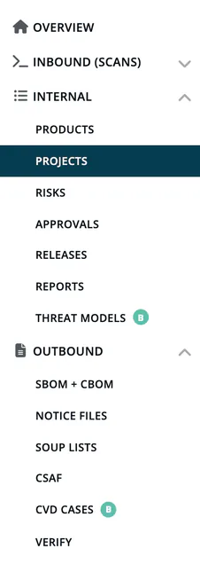

# Capabilities

Beyond the platform **core** (projects, modules, scans, components,
SBOM/notice generation, basic reporting), ***TrustSource*** offers a
number of optional **capabilities** that target specific compliance
domains or workflows. Each capability is licensed independently and may
or may not be present in a given account.

> [!NOTE]
> **"Capability" vs. "Module".** In this help portal, a *capability* is
> an optional functional bundle of the platform: a license-gated
> feature area. Inside the application itself, the word *module* refers
> to a deployment artefact of a software product. The two concepts are
> unrelated despite the similar surface vocabulary.

## In this section

| Capability | What it adds | Required feature flag |
|---|---|---|
| [OSCAR Chat](01-oscar-chat.md) | AI assistant for compliance questions and platform usage | `chat` |
| [Risk](02-risk.md) | Risk register, portfolio views and risk-task management | `risks` |
| [Product](03-product.md) | Product-level classification incl. CRA scope, contacts, support data | `products` |
| [Medical](04-medical.md) | SOUP reports and MDR/IVDR module classification | `medical` or plan feature `soup_report` (SOUP); Medical account type (MDR/IVDR) |
| [CVD](05-cvd.md) | Coordinated Vulnerability Disclosure intake and triage | `psirt` |
| [CSAF Trusted Provider](06-csaf-trusted-provider.md) | Publish CSAF advisories as a registered trusted provider | `csaf` |
| [Threat Modeling Agent](07-threat-model-agent.md) | Automated STRIDE-per-Element threat modelling with human-in-the-loop review | `threat` |

The exact set of capabilities available on your account depends on
which subscription you hold. Pages in this help portal that depend on a
capability say so at the top.

> [!TIP]
> All capabilities listed above are available in the SaaS edition. The
> [Community Edition](../../ce/index.md) includes a subset; each
> capability page states its CE availability.

## Trainings

Independent of the functional capabilities above, the **Trainings**
entry in the Knowledge menu opens the training catalog: e-learning
courses on TrustSource and software supply chain topics, filtered by
**Level** and **Tags**. Each course card shows whether the course is
**Free** or what it costs; a paid course is bought through a checkout
from the course. If your account admin entered the address of your own
training portal, the entry opens that portal instead.

See the [Trainings page](../05-knowledge/08-trainings.md) for how the
training area looks in the app.

